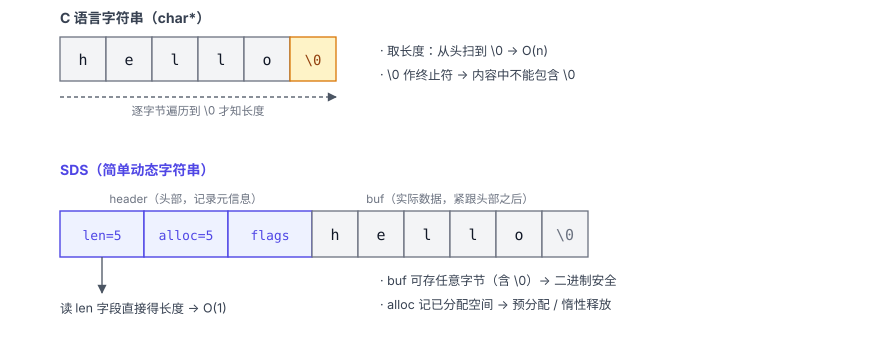
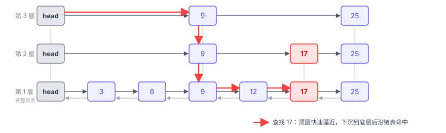
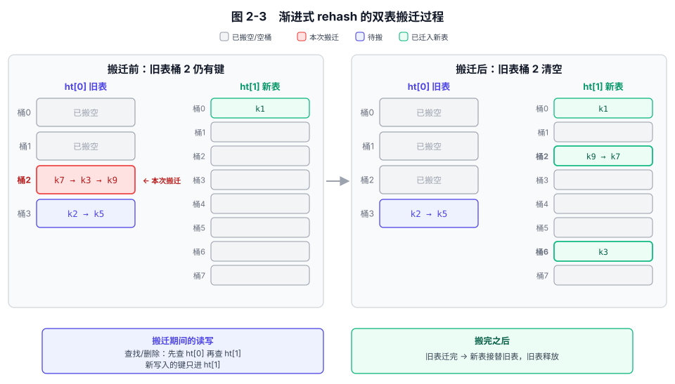
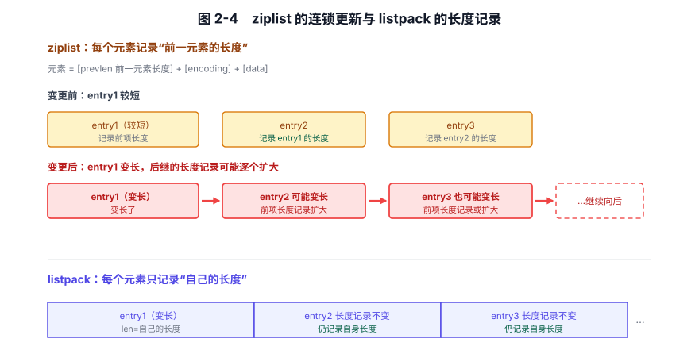
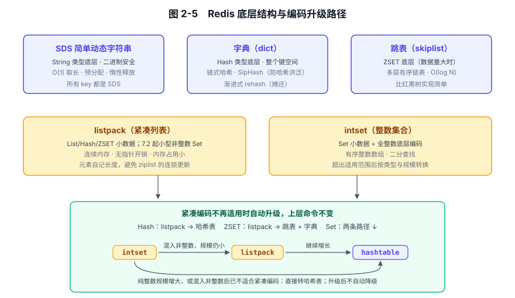
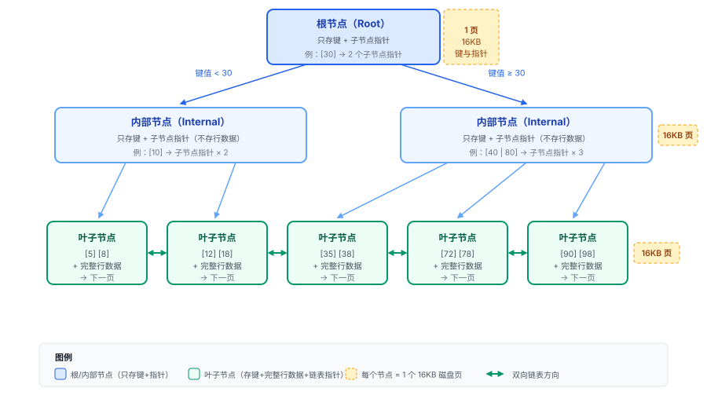
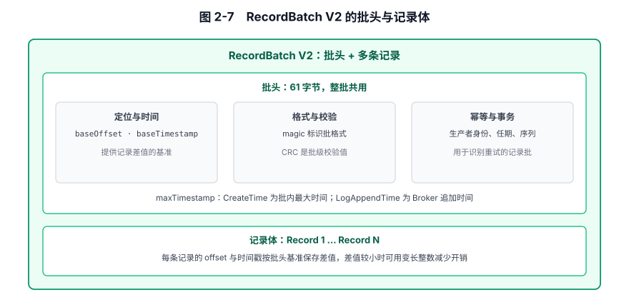
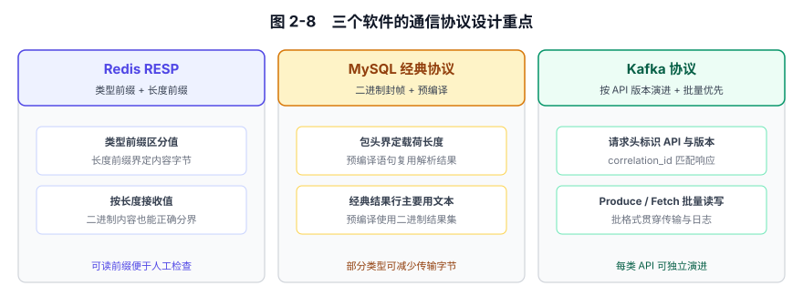

# 第 2 章 数据结构与协议 — 为各自的目标而设计

## 本章导读

数据怎样组织，会影响查询时怎样查找和遍历，以及哪些结果需要临时计算。

例如，排行榜既要查询前 100 名，也可能要查询某个用户的名次。这两种操作需要的信息不同。MySQL 中给 score 建索引，可以按索引顺序读取榜单前列；普通 B+ 树索引记录键的顺序，却不直接记录排名，要算名次，通常还得统计排在前面的记录。

Redis 的有序集合（ZSET）可以用 ZREVRANK 查名次。它的跳表额外维护了跨度信息，能在定位元素时一并算出位置。只查榜单前列时，有序索引就够了；还要频繁查询任意用户的名次时，结构是否直接提供名次查询，就影响选择。

这一章就从访问方式出发，看 Redis、MySQL 和 Kafka 怎样组织数据、怎样与客户端通信。重点在于理解：一种结构或协议方便了哪些操作，又增加了哪些成本。

## 2.1 问题的本质

任何一个有客户端和服务端的软件，都绕不过这两个问题：

第一，数据用什么格式来组织。这个问题直接关系到操作复杂度、内存开销以及“哪些查询快、哪些查询慢”。跳表适合范围扫描和有序操作，哈希表适合 O(1) 点查，B+ 树为磁盘页对齐和范围扫描而设计，紧凑列表胜在内存密度。

第二，客户端和服务端怎么对话。有三个关键点：采用文本、二进制还是混合编码，在人工可读性与传输开销之间怎样取舍；多条消息怎样组织，哪些工作可以通过批量处理或复用来减少；格式变化后，客户端和服务端怎样协商并保持兼容。

## 2.2 内部数据结构：为核心目标而设计

### 2.2.1 Redis：驻留内存的简洁数据结构

Redis 的数据结构都受同一个约束限制：**全部驻留内存**。内存意味着随机访问的成本远低于磁盘、数据访问对 CPU 开销比对 I/O 更敏感、容量有物理上限，所以数据结构要尽量省内存、尽量减少 CPU 操作。下面五个结构都是对这条约束的回应：SDS、跳表、字典（dict）偏重查询效率，ziplist/listpack 和 intset 偏重内存密度。

**SDS（简单动态字符串）** 是 Redis 最基础的字符串实现。普通 C 字符串要遍历到结尾才能知道长度；SDS 在数据前保存 `len`（当前长度）、`alloc`（已分配空间）和类型标记。读取长度只需访问头部，是 O(1) 操作；数据本身也不依赖结尾零字节判定长度，因此能存储任意二进制内容。

追加时，SDS 可以预留空间，减少后续分配；缩短时也可以保留空间供再次追加。它多占用头部和暂时未使用的空间，换来较少的遍历与内存分配。图 2-1 展示了它与 C 字符串的内存布局。


图 2-1　SDS 与 C 字符串的内存布局对比：同一个 hello 的两种存法，差别集中在 SDS 的头部。

**跳表（skiplist）** 用于 Redis 有序集合的 skiplist 编码。这种编码同时维护 dict 和跳表：member→score 的查找走 dict，ZSCORE 是 O(1)；按顺序读取一段元素走跳表，ZRANGE 是 O(log N + M)，M 为返回元素数。

跳表是多层有序链表，最底层是一条完整的有序双向链表，上面几层是抽稀的索引层，每隔几个节点保留一个指针。节点层数按随机结果决定，跳表高度大概率落在 O(log N)。每条向前指针还记录一个跨度（span），表示沿它前进跨过了多少个元素。

查找时从最顶层快速定位到目标附近，再逐层下沉到精确位置。查找、插入和删除的平均时间复杂度都是 O(log N)。范围扫描先定位起点，再沿底层链表前进（O(log N + M)），比红黑树的中序遍历更直接。

插入时按新节点的层数，逐层更新前驱节点的前向指针和跨度，不需要旋转或再平衡。

选跳表而非红黑树，是因为实现更简单、范围操作更直接。多层索引长什么样、查找怎么走，见图 2-2。


图 2-2　跳表的多层索引与查找路径：以查找 17 为例。

定位元素时，把查找路径上各层经过的跨度累加，就能得到位置；排行榜的名次由此计算，不必从表头逐个计数。

**字典（dict）** 是 Redis 哈希类型和键空间使用的链式哈希表。它使用带随机种子的 SipHash 计算哈希值，以链表处理冲突。

渐进式 rehash 使用旧表 `ht[0]` 和新表 `ht[1]`。扩容或缩容时，Redis 不一次搬完所有键，而是在后续操作和定时任务中逐步迁移。迁移期间，新写入的键进入新表，查找和删除要兼顾两张表；迁移结束后，新表接替旧表。

搬迁工作分散到多次操作中，可以减少集中搬迁造成的长停顿。一个桶里的元素一起迁移，因此桶内元素较多时，单次迁移也可能耗时较长。图 2-3 以一个旧桶的迁移展示双表如何切换。


图 2-3　渐进式 rehash 的双表搬迁过程：以旧表桶 2 的一次搬迁作前后对照。

**压缩列表（ziplist）与紧凑列表（listpack）** 都把元素紧挨着放在连续内存中，减少指针开销，插入时也都可能搬移后续字节。ziplist 的元素记录前一个元素的长度；前一个元素变长后，后一个元素的长度记录可能随之扩大，并继续影响后面的元素。listpack 改为记录元素自身的长度，切断了这种连锁依赖。两种格式的差别见图 2-4。


图 2-4　ziplist 的连锁更新与 listpack 的长度记录：同一个元素变长，在两种格式里的不同后果。

**整数集合（intset）** 是 Redis 集合类型在成员较少且全为整数时使用的紧凑编码。它将整数有序地放在连续数组中，用二分查找；编码选能容纳全部成员的最窄宽度。插入超出当前宽度的整数时，整个数组升级到更宽的编码；删除大值后不会自动降级，可能因此多占一些空间。

集合不再适合这种编码时，底层结构也会转换。插入非整数成员后，Redis 7.2 起可在规模较小时先转为 listpack，否则转为哈希表；纯整数成员超过 intset 的元素数量阈值时则直接转为哈希表。这些转换对上层命令透明，路径见图 2-5。


图 2-5　Redis 五种底层结构与升级路径：五种结构各成卡片，底部标出小数据编码的升级去向，其中 Set 有两条独立的转换路径。

### 2.2.2 MySQL：面向磁盘页和通用查询的 B+ 树与行格式

MySQL（InnoDB）以页组织磁盘数据，默认页大小为 16KB。数据不在缓冲池时，查找需要从磁盘读入相关页，经过的页数因此影响 I/O 成本。

**B+ 树** 是 InnoDB 唯一的主索引结构。一棵 B+ 树从上到下有根节点、内部节点和叶子节点。内部节点主要保存键和子页指针，一页可以容纳较多分支，减少从根到叶需要访问的页数。叶子之间用双向链表串联。聚簇索引的叶子保存完整行数据，InnoDB 的表本体按主键组织成树。二级索引的叶子保存索引键和主键值；读取索引之外的列时，再用主键回到聚簇索引取数据，这一步叫回表。

点查沿树从根到叶定位；范围扫描找到起点后，可以顺着叶子链继续读取。哈希索引擅长等值查找，却不维护这种键顺序。B+ 树适合同时需要点查和有序访问的关系查询。

B+ 树插入新键可能触发页分裂（页满时一拆为二，级联向上），分裂会增加页修改和日志记录，之后还可能增加脏页刷盘的工作量。跳表插入更新相关指针与跨度，没有页分裂。图 2-6 画了一棵三层的示例树。


图 2-6　InnoDB B+ 树三层结构：一棵示例树，每个方框对应一个 16KB 磁盘页。

这张图与图 2-2 的跳表对照：两者都为顺序访问准备了底层结构，差别在于，跳表按单个内存节点组织数据，B+ 树则把一整个 16KB 磁盘页作为节点——节点的大小，对齐的是所在介质的访问单位。

**行格式（Row Format）** 决定一行数据怎样放进页里。以 Dynamic 为例，行太长时，可以把部分较长的变长列移到溢出页，行内留下指针。读取被移出的列时，沿指针访问溢出页。索引页由此可以容纳更多记录。

**自适应哈希索引** 是 InnoDB 在 B+ 树之上的额外一层。InnoDB 根据索引页上的查询模式，按合适的索引键前缀在内存中建立哈希索引；能够命中它的查询，可以通过平均 O(1) 的哈希查找直接定位记录，省去 B+ 树 O(log N) 的逐层查找。这层哈希也要占内存、维护自身结构，并可能带来锁竞争。查找省下的时间抵不过维护成本时，关闭它反而更合算。

### 2.2.3 Kafka 的 RecordBatch：批量、顺序、演进

Kafka 需要一种适合**磁盘顺序追加、批量压缩和格式演进**的数据结构。它采用 RecordBatch，把多条消息组织成一个批次。

**RecordBatch 是 Kafka 组织消息的基本单元。** 生产者把同一分区的消息组织成批发送，Broker 按批追加到日志段，消费者再成批拉取。协议与日志复用批格式，减少重新组织数据的工作；改变压缩方式时则可能需要重新编码。

RecordBatch V2 将整批共享的信息放在头部。表 2-1 按用途归组，图 2-7 标出批头与记录体的关系。

**表 2-1　Kafka RecordBatch V2 头部字段分组**

| 用途 | 字段 | 作用 |
|---|---|---|
| 定位与边界 | `baseOffset`、`batchLength`、`lastOffsetDelta`、`recordsCount` | 界定批在日志中的范围、长度与记录数 |
| 压缩与时间 | `attributes`、`baseTimestamp`、`maxTimestamp` | 记录压缩、时间戳类型与事务标记，并给记录提供时间基准；LogAppendTime 模式下，`maxTimestamp` 记录 Broker 的追加时间 |
| 校验 | `CRC` | 一批保存一个校验值 |
| 幂等与事务 | `producerId`、`producerEpoch`、`baseSequence` | 以生产者身份、任期和序列识别重试，支持幂等与事务 |
| 格式与任期 | `magic`、`partitionLeaderEpoch` | 标记批格式版本和写入时的 Leader 任期 |

头部之后是消息记录。记录中的偏移量和时间戳保存为相对批头基准的差值；差值较小时，变长整数编码能进一步减少逐条开销。


图 2-7　RecordBatch V2 字段分组：按功能分组，不表示磁盘字节顺序。整批消息共享 61 字节头部中的元数据，记录中的偏移量和时间戳使用相对差值。

同一批中的消息共享元数据和 CRC；需要压缩时，也以批为单位。新旧格式能否共存，取决于读写双方支持的版本；`magic` 用来辨认批格式版本。Kafka 重点服务追加写和按 offset 定位后的连续读取，不提供按业务 key 的点查。

## 2.3 通信协议：客户端和服务端怎么对话

### 2.3.1 Redis RESP：能被人眼读懂的极简协议

Redis 的协议叫 RESP（REdis Serialization Protocol）。它的设计目标包括实现简单、解析快速、便于人工调试，以及能表达所有 Redis 命令和返回值。文本参数可以直接辨读，也能用 `nc` 手工发送简单命令。

以 RESP2 为例，首字节区分五种基本类型：`+` 是简单字符串，`-` 是错误，`:` 是整数，`$` 是批量字符串，`*` 是数组。数组先给出元素个数，批量字符串先给出内容的字节长度，解析器据此识别边界。

例如，`SET key value` 是一个包含三个批量字符串的数组：

```text
*3\r\n
$3\r\nSET\r\n
$3\r\nkey\r\n
$5\r\nvalue\r\n
```

RESP 在命令内容之外还发送文本前缀和长度信息：上面的 `SET key value` 编码后有三十多个字节。Pipeline 把多条独立编码的命令连续发出，减少网络往返；每条命令各自返回结果，命令格式不变。

Redis 6.0 引入 RESP 3，客户端可用 `HELLO` 在握手时选择协议版本，服务端仍兼容 RESP 2。切换到 RESP 3 后，部分命令的返回类型会变（如 `HGETALL` 从扁平数组变为 Map），客户端需要适配。

### 2.3.2 MySQL 二进制协议：封帧与预编译

MySQL 采用**二进制封帧**，但经典查询的结果行主要按文本编码；预编译语句则使用二进制结果集。在高并发 OLTP（联机事务处理）中，预编译通常可以复用解析结果，二进制结果集也能减少部分数据类型的传输开销。

MySQL 协议分为几个阶段：握手（服务端发送能力标志和认证随机数、客户端按认证插件要求回传认证响应）、命令（客户端发送 SQL 或预编译语句 ID）、响应（服务端返回结果集或 OK/ERR）。

MySQL 经典协议包先有一个 4 字节头：3 字节记录后面载荷的长度，1 字节记录包序号。接收方因此知道这一包有多少字节。

包内的整数再按字段选择定长或变长编码。采用变长编码时，小整数可以少占字节，大整数再使用更长的编码；采用长度前缀编码的字符串，则先给长度，再放内容。固定包头界定整包边界，包内字段再按各自的编码规则确定边界，这是两个层次。

**预编译语句** 是 MySQL 协议在“效率”上的关键设计。客户端先用 `COM_STMT_PREPARE` 把一条带占位符 `?` 的 SQL 模板发给服务端，服务端完成解析与语义检查、返回一个 `statement_id`。此后每次执行只需发 `COM_STMT_EXECUTE` + `statement_id` + 占位符的值。解析结果通常可以复用，执行计划则在每次执行时按当时的统计信息重新生成，反复执行时省掉的是逐次解析的 CPU 开销。这和 Redis Pipeline 不同：Pipeline 省的是网络往返（RTT，Round-Trip Time），预编译语句省的是服务端 CPU。

**二进制结果集** 按列类型编码行数据，整数、浮点数与日期时间字段需结合列元数据与协议规则解析，不再能直接按文本辨读。传输字节数要按类型和值比较：部分数值与日期时间数据的二进制表示可以更小，短小整数的文本表示也可能更省字节，字符串列两种编码几乎一样大。

### 2.3.3 Kafka 请求/响应协议：统一头部、版本化、批量优先

Kafka 的协议按请求类型组织。Produce、Fetch、Metadata 等请求各有自己的 Schema 和版本，可以独立演进。

请求头中的 `api_key` 标识类型，`api_version` 指定格式版本，`correlation_id` 匹配请求与响应，`client_id` 识别请求来源。客户端可先通过 `ApiVersions` 查询 Broker 支持的版本范围，再选择双方共同支持的版本。

**批量优先** 主要体现在消息写入与读取路径。Produce 可以携带多个分区的消息批，Fetch 按分区和 offset 拉取记录。多条记录合并处理，可以摊薄请求与传输开销。


图 2-8　三个软件通信协议的设计重点

## 2.4 横向对比

表 2-2 对照三个软件的内部数据结构与通信协议，比较它们如何适应各自的主要访问方式。

**表 2-2　三个软件数据结构与协议的横向对比**

| 维度 | Redis | MySQL | Kafka |
|------|-------|-------|-------|
| 核心目标 | 低延迟 | 事务与通用查询 | 高吞吐 |
| 存储介质定位 | 全内存（磁盘仅为恢复） | 磁盘为主（内存是缓存） | 磁盘日志本体（顺序追加） |
| 核心数据结构 | SDS / 跳表 / 字典 / listpack / intset | B+ 树 + Dynamic 行格式 + 自适应哈希 | RecordBatch V2（批量+差值编码） |
| 数据结构优化目标 | O(1)/O(log N) + 低内存占用 | 减少查找时访问的页数 + 兼顾点查与范围扫描 | 批量压缩 + 顺序追加 + 格式可演进 |
| 编码与分帧特点 | 类型前缀与长度信息组织 RESP 数据 | 固定包头界定载荷；结果行按文本或二进制编码 | 长度前缀界定消息，请求头标明 API 与版本 |
| 协议核心设计 | 5 种前缀字符（RESP2），人眼可读 | 预编译语句 + 二进制结果集 | api_key + api_version + correlation_id |
| 批量/复用策略 | Pipeline（连续发送多条独立命令） | 预编译语句（复用解析结果，多次执行） | RecordBatch（同一分区的多条消息组成一批） |
| 版本演进方式 | HELLO 版本协商（6.0 起，此前靠手工约定） | 能力标志（握手时交换） | api_version（每种请求独立版本号） |
| 人工可读性 | 文本前缀与文本参数可直接辨读，参数也可包含二进制数据 | SQL 与经典查询的文本结果行可辨读，预编译结果集需按类型解码 | 需按协议解码二进制字段 |

## 2.5 架构启示

数据结构决定哪些访问可以直接完成；协议则决定每次访问还要重复多少工作。

### 启示一：核心查询决定额外结构的价值

本章开头的排行榜，给 score 建索引已能高效取前 100 名；若还要频繁查询任意用户的名次，索引并没有直接保存所需的位置信息，ZSET 维护的跨度才有价值。额外结构会增加内存和更新成本。

### 启示二：协议设计服务于主要访问方式

网络往返多时，Redis Pipeline 把多条命令连续发送；相同 SQL 反复执行时，MySQL 预编译复用解析结果；消息成批写入和读取时，Kafka 的批格式分摊传输与存储开销。三种做法处理的瓶颈不同。协议不必暴露内部结构，但其传输单位和复用边界应与常见访问方式相符。

### 启示三：版本边界决定升级的牵连范围

MySQL 在握手时协商连接能力，Kafka 为每类 API 单独设版本，RESP 3 则用 `HELLO` 增加版本入口。为了兼容尚未升级的客户端，服务端往往需要同时支持新旧格式。按 API 分版本能缩小一次改动牵连的接口范围，也要求服务端维护更多兼容分支。

## 2.6 小结

三个软件的结构和协议，都围绕常见访问方式组织。Redis 为不同操作选择不同的内存结构，InnoDB 用页式 B+ 树兼顾点查和有序访问，Kafka 用批组织追加与传输。
