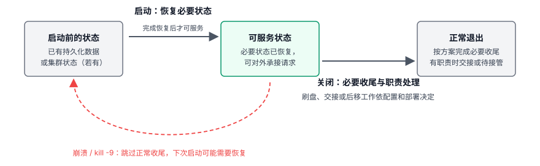
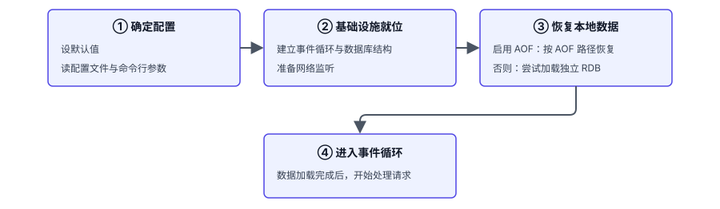
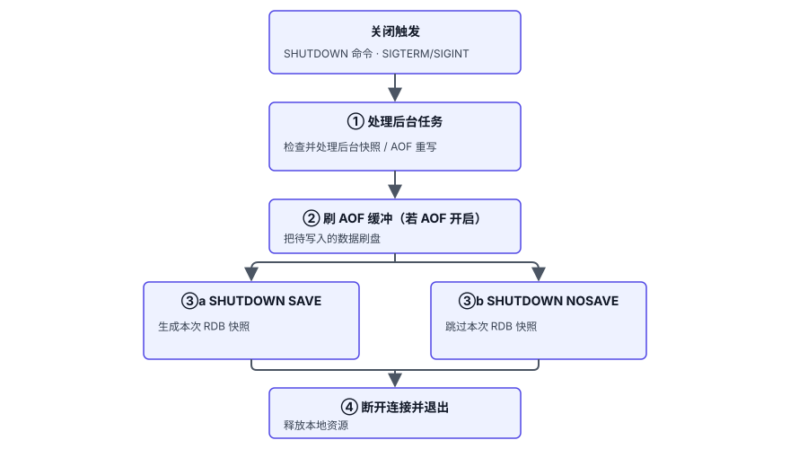
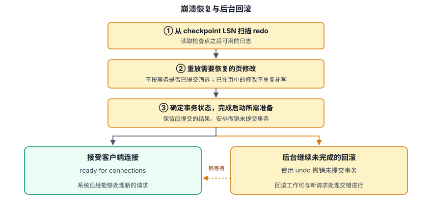
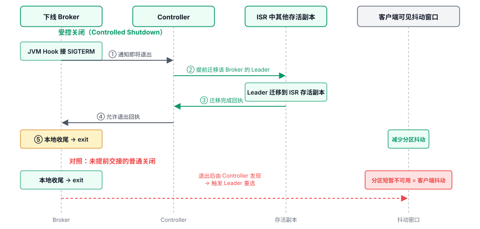

# 第 3 章 生命周期管理 — 优雅启动与关闭

## 本章导读

发版时用 `kill -9` 结束进程，再重新启动，进程就没有机会完成清理和持久化收尾。启动时要恢复数据、确认事务状态、准备对外服务；关闭时要处理在途请求、保存必要的数据、交接集群职责。忽略其中一步，重启就可能变成一次事故。

同样是 `kill -9`，Redis 可能丢失尚未持久化的数据，持久化配置会影响丢失量（详见第 4 章）；MySQL 重新启动时进入 InnoDB 的崩溃恢复（crash recovery）流程；Kafka 则可能触发分区的 Leader 重选、让上游业务短暂抖动。单机实例需要恢复本地状态；Redis、MySQL 的复制或集群部署也可能触发故障转移；Kafka Broker 下线则会影响它承载的分区。

## 3.1 问题的本质

对有状态软件，启动的门槛不是进程存在，而是已恢复到能够处理请求的状态。Redis 要重建内存键空间，MySQL 要确定事务状态，Kafka 要恢复分区日志和节点职责。

关闭时则要确定：哪些数据必须保存，哪些工作可以留到以后处理，哪些职责要在退出前交接。图 3-1 概括了启动与关闭各自处理的状态变化；崩溃或强制退出跳过正常收尾，可能造成数据损失或把工作留到下次启动。

图 3-1　启动恢复与关闭收尾

## 3.2 Redis 的做法

Redis 运行时的键空间在内存中。有本地持久化时，重启要从 AOF 或 RDB 重建键空间；关闭时则要决定是否再生成一次 RDB，同时完成已开启的 AOF 刷盘。

### 3.2.1 启动四阶段

**第一段：确定配置。** Redis 先设默认值，再读配置文件和命令行参数，供后续初始化使用。

**第二段：建立基础设施。** Redis 创建事件循环和内存中的数据库结构，并准备网络监听。监听端口打开，还不表示已有数据恢复完成。

**第三段：恢复数据。** 启用 AOF 时，Redis 按 AOF 路径恢复；未启用时，才尝试加载独立 RDB。AOF 通常比定期快照保留更多近期写入，因此这一顺序关系到恢复点。图 3-2 展示了数据恢复在启动过程中的位置。

图 3-2　Redis 启动流程

**第四段：开始处理请求。** 本地数据加载完成后，Redis 才进入事件循环，对外提供服务。

### 3.2.2 关闭：两种触发，一套流程

客户端发出 `SHUTDOWN`，或进程收到 SIGTERM/SIGINT，都会进入正常关闭流程。有副本时，Redis 7.0 起可在退出前短暂等待副本追平；等待超时后继续退出。随后才是本地持久化与连接收尾。

图 3-3　Redis 正常关闭流程

关闭时，Redis 先处理未完成的后台快照或 AOF 重写，再把已开启的 AOF 缓冲刷盘。`SHUTDOWN SAVE` 在退出前生成 RDB；`SHUTDOWN NOSAVE` 跳过本次 RDB 快照，仍会完成 AOF 刷盘。随后断开客户端并释放资源。

### 3.2.3 用信号触发优雅关闭

SIGTERM/SIGINT 让 Redis 有机会执行上述收尾；SIGKILL（`kill -9`）直接结束进程，无法等待 AOF 刷盘或 RDB 保存完成。MySQL 也通过退出信号进入正常关闭流程；Kafka 的 SIGTERM 则经 JVM Shutdown Hook 交给应用处理。

## 3.3 MySQL 的做法

MySQL 比 Redis 多了事务状态的约束。异常退出后重新启动时，要处理崩溃恢复；关闭时可以选择把部分清理留到以后。

### 3.3.1 启动链路：事务恢复是关键环节

MySQL 异常退出后重新启动，也要完成配置、存储引擎和网络准备，但决定何时能接请求的关键工作是 InnoDB 的事务恢复。它从 checkpoint（检查点）标记的位置扫描 redo log，补上已记录但尚未写回数据页的修改；redo 重放不按事务是否提交来筛选。未提交事务还要由 undo log 撤销。图 3-4 区分了接受连接前必须完成的恢复与可以继续进行的回滚。

图 3-4　InnoDB 崩溃恢复与后台回滚

`ready for connections` 表示 InnoDB 已完成必要的 redo 恢复，可以接受连接；未完成的回滚可在后台继续。回滚事务持有的锁可能阻塞新请求，大事务会增加回滚工作量。

### 3.3.2 innodb_fast_shutdown：把清理工作在关机与开机之间分摊

MySQL 用 `innodb_fast_shutdown` 的 0、1、2 三档决定把多少清理工作放在关机前，多少留到下次启动或运行期。表 3-1 比较的是工作时机，不是一致性等级；三档都以保留已提交事务为前提。

**表 3-1　innodb_fast_shutdown 三档对比**

| 维度 | 0 = 完全关闭 | 1 = 快速关闭（默认） | 2 = 模拟崩溃 |
|------|--------------|----------------------|--------------|
| 关闭时完成 | 刷脏页，并完成 purge、修改缓冲合并等清理 | 刷脏页，跳过完整 purge 与修改缓冲合并 | 刷 redo，不刷数据页 |
| 留给之后 | 下次启动需要处理的清理较少 | 运行期继续完成未做完的清理 | 下次启动执行崩溃恢复 |

默认档位 1 保留了脏页刷盘，把完整清理留到运行期，避免日常重启等待这部分工作。估计关闭时间时，除了档位，还要计入脏页和长事务等遗留工作量。

## 3.4 Kafka 的做法

Kafka 的消息保存在分区日志中。启动时，Broker 既要检查本地日志，也要取得集群元数据；关闭时，除了本地收尾，还可能需要交出分区 Leader 职责。

### 3.4.1 启动链路：服务就绪前的依赖

以 KRaft 模式为例，Broker 要知道自己负责哪些分区，检查相应的日志和索引，并追上所需的元数据。网络组件准备好，并不表示这些工作已经完成；满足恢复、授权和控制面的条件后，Broker 才处理请求。请求最终由 Handler 线程池执行，它的分工在第 5 章讨论。

异常退出后，Broker 检查追加日志的完整性，截断残缺尾部，并恢复索引及生产者等状态。消息本身保存在日志里，不需要像 InnoDB 那样再重放成另一套业务数据页。

### 3.4.2 关闭：普通关闭 vs 受控关闭

**普通关闭**会停止请求处理、断开连接并完成本地日志收尾，但不保证在途请求都能把结果返回客户端。如果 Broker 承担的 Leader 职责尚未迁移，Controller（集群控制器）要在它退出后重新选主，分区可能短暂不可用。

**受控关闭（Controlled Shutdown）**在退出前通知 Controller，让其他存活的同步副本接替 Leader，得到交接确认后再完成本地收尾。交接的是已有副本的角色，不是关机时复制全部消息。图 3-5 对照了退出前交接与退出后重选的区别。

图 3-5　Kafka 受控关闭与普通关闭对比

受控关闭要求 Controller 可达，且相关分区的同步副本集合（ISR）中有位于其他 Broker 的存活副本，能在期限内完成迁移。条件不满足或等待超时，Broker 就转入普通关闭。默认启用的受控路径增加退出前的协调时间，减少正常下线造成的分区抖动。

## 延伸：容器环境给三类软件增加的启停约束

部署到 Kubernetes（K8s）后，终止宽限期覆盖摘流（停止向实例分配新流量）、hook（终止钩子）和进程收尾；超时仍未退出，进程会被强制结束。Redis 的持久化、MySQL 的事务收尾、Kafka 的 Leader 交接所需时间不同，不能只按进程收到信号来判断关闭完成。摘流信息的传播需要时间；保存或交接则要看各自的完成信号，而不只是等待了多久。

启动也会受探针影响。如果把“数据库还在恢复”当成存活探针（liveness probe）检查失败，编排系统就可能反复重启它，恢复一次次被打断重来。配置启动探针（startup probe）后，存活探针和就绪探针（readiness probe）会等待它成功再开始执行，给启动恢复留出时间；随后由就绪探针判断实例是否具备接收流量的条件。

## 3.5 横向对比

表 3-2 把三家的就绪条件、关闭收尾与职责交接放在一起比较。

**表 3-2　三个软件的启动与关闭**

| 维度 | Redis | MySQL | Kafka |
|------|-------|-------|-------|
| 开始处理请求的门槛 | 按配置恢复内存键空间 | 完成必要的 redo 恢复；未完成的回滚可在后台继续 | 分区日志、元数据与授权等准备就绪 |
| 退出前的本地数据收尾 | 已开启的 AOF 刷盘；是否生成本次 RDB 可选 | 按档位刷数据页或 redo | 日志刷盘与本地收尾 |
| 可以省略或留到之后的工作 | NOSAVE 省略本次 RDB 快照 | 完整清理可后移；档位 2 留待下次崩溃恢复 | 普通关闭把 Leader 重选留到退出后 |
| 退出时的集群职责 | 可等待落后副本追平；接管取决于部署方式 | 角色接管取决于复制或集群方案，不由关闭档位决定 | 受控关闭先协调 Leader 交接 |

## 3.6 架构启示

### 启示一：接受请求前，哪些状态必须就绪

进程已启动、端口已监听，都不足以说明请求能得到正确结果。反过来，要求所有后台清理完成后才接受请求，会无谓延长停服。划定就绪门槛的依据，是未完成的工作是否影响新请求的正确性。InnoDB 的必要 redo 恢复要在接受请求前完成；未完成的回滚可以留在后台，回滚事务持有的锁可能增加新请求的延迟。

### 启示二：退出要有可确认的完成条件

退出方案需要分别定义数据保存、在途请求处理和职责交接的完成条件，并约定等待超时后如何退出。Kafka 的受控关闭在具备可接替副本、交接按时完成时，能减少计划下线时的分区抖动；否则转入普通关闭。

### 启示三：快速关闭改变后续工作的安排

Redis 可以省略本次快照，MySQL 可以把清理留到运行期，Kafka 则可以把选主留到 Broker 退出后。它们缩短的是同一个关闭阶段，改变的保证和后续负担却不同。评估快速关闭的代价，需要明确省去的工作是否还要补做、由谁完成，以及会延长哪个阶段。

退出后能保住哪些数据，取决于持久化配置与退出流程。

## 3.7 小结

启动的门槛是必要状态已恢复。关闭时要确认必要的收尾工作已完成，并说明进程退出后，哪些集群职责还需要其他节点接手。把工作移到运行期、下次启动或其他节点，可以缩短本次关闭前的等待；方案也要说明后续工作由谁完成，以及超时会带来什么后果。
