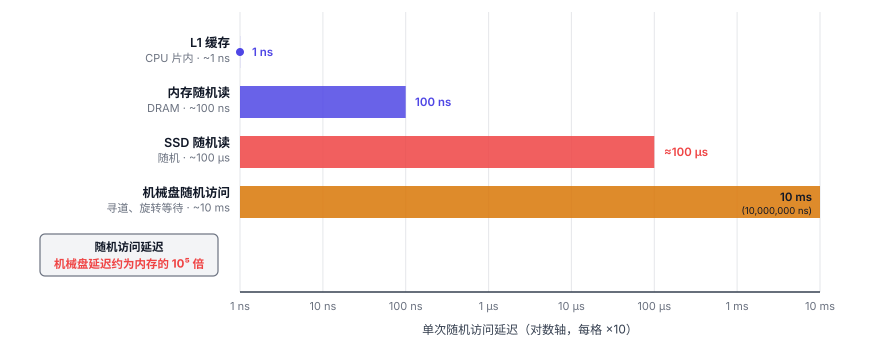
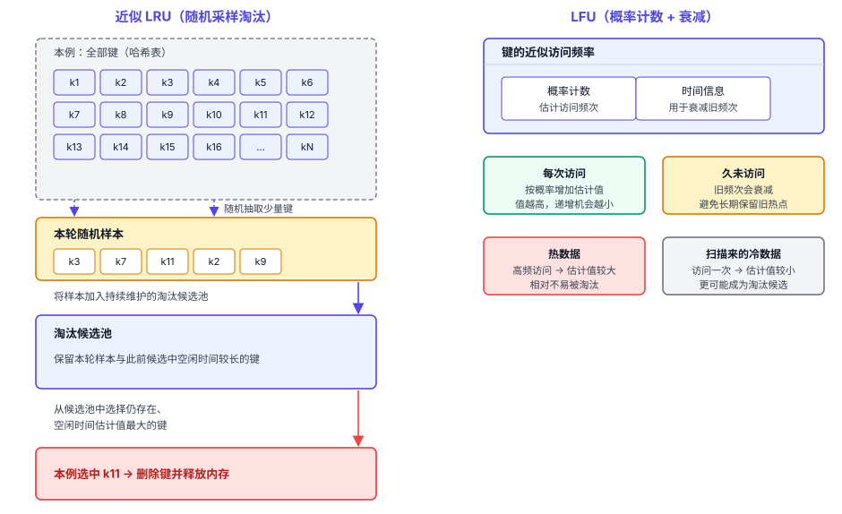
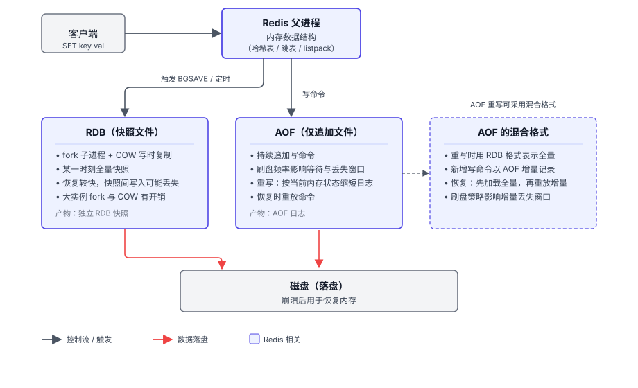
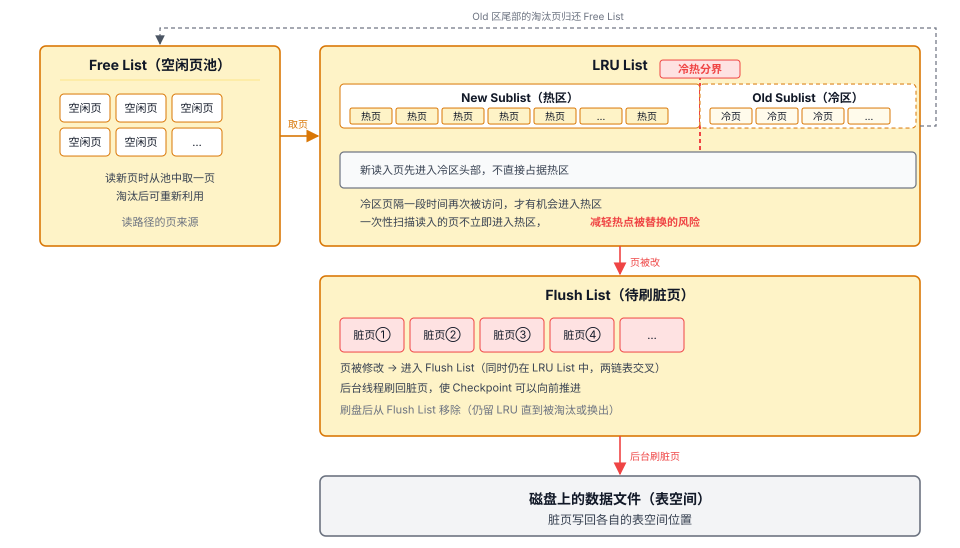
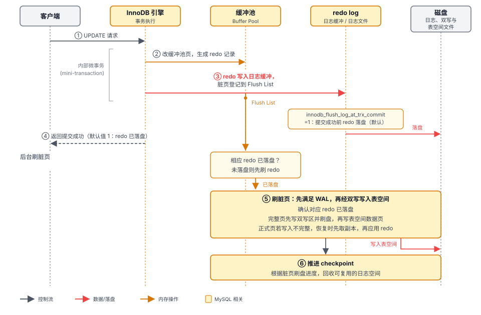
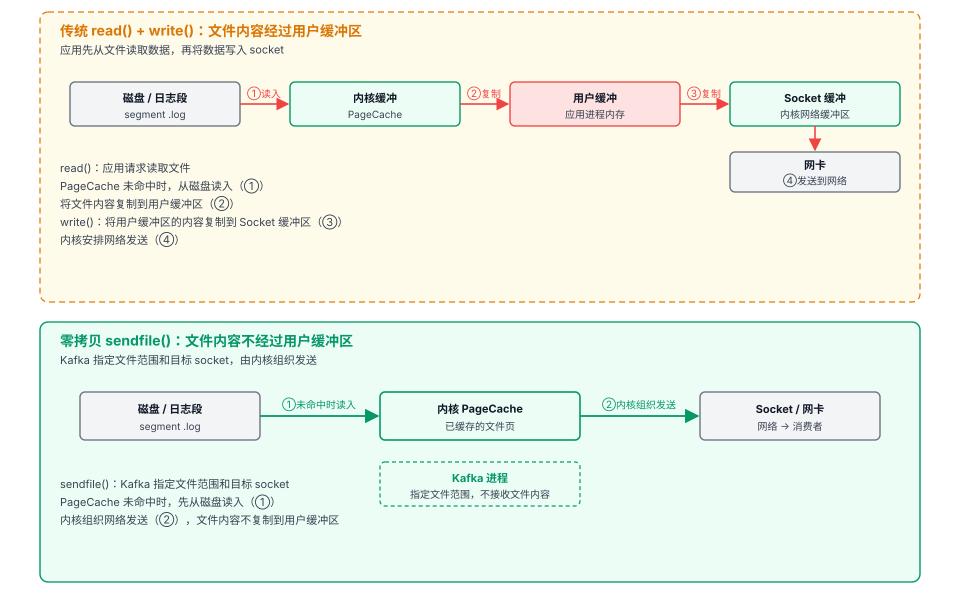

# 第 4 章 内存与磁盘 — 速度与持久化的平衡

## 本章导读

数据放在哪里，影响访问路径：读取内存中的数据可以省去磁盘访问，磁盘上的随机读取会增加请求延迟。内存容量受成本和硬件约束，磁盘能容纳比全内存方案更多的数据。还要决定哪些写入要等待落盘；未持久化的数据在断电后会丢失。

Redis 以内存保存运行数据，磁盘用于持久化和恢复；MySQL 用缓冲池加速磁盘数据的访问；Kafka 把顺序日志的缓存交给操作系统的 PageCache。本章看三种分工怎样匹配各自的访问方式，以及它们带来的容量、延迟和恢复代价。

缓存选型不能只看数据是否驻留内存。MySQL 的 MEMORY 表把数据放在内存中，常用的 InnoDB 则用缓冲池缓存磁盘页；所需页不在缓冲池时，需要从数据文件读入，SQL 处理还包括解析和优化的开销。Redis 直接在内存中操作键值对象，适合高频访问的小数据；需要事务和复杂查询时，MySQL 的能力更匹配。

## 4.1 问题的本质

存储介质的延迟和带宽差距，决定了这些分工是否划算。表 4-1 只比较数量级，不作硬件基准；实际值随设备与负载变化。

**表 4-1　存储介质的访问延迟与吞吐量级**

| 存储介质 | 典型延迟或带宽 | 相对内存：延迟倍数／带宽差距 | 是否持久 |
|----------|-------------|----------------------|---------|
| **延迟组：单次随机访问延迟** | 基准：内存随机读 ~100ns = 1× | | |
| CPU L1 缓存 | ~1ns | 延迟约为内存的 1/100 | 否 |
| 内存（DRAM） | ~100ns | 基准（1×） | 否 |
| SSD（随机读） | ~100μs（数量级示意） | 延迟约为内存的 1000 倍 | 是 |
| 机械盘（随机访问） | ~10ms | 延迟约为内存的 100000 倍 | 是 |
| **带宽组：顺序读写带宽** | 基准：内存顺序带宽 ~数十 GB/s = 1× | | |
| 内存（DRAM） | ~数十 GB/s（典型 20–100GB/s，服务器多通道更高，随内存通道数与代际变化） | 基准（1×） | 否 |
| SSD（SATA，顺序写） | ~300–500MB/s | 带宽比内存约低 1–2 个数量级 | 是 |
| SSD（NVMe，顺序写） | ~2–14GB/s（随接口代际与设备变化） | 可接近内存带宽，也可能低一个数量级以上 | 是 |
| 机械盘（顺序写） | ~100–280MB/s | 带宽比内存约低 2 个数量级 | 是 |

随机访问延迟决定一次读取要等多久，顺序带宽决定一段时间能搬多少数据。两组数字不能相互替代。图 4-1 把单次访问延迟放到对数轴上。

图 4-1　存储层次访问延迟的数量级

机械盘的顺序读写能避开反复寻道；SSD 没有机械寻道，小块随机 I/O 仍可能受 IOPS 约束。数据放在哪里与写入何时落盘，是两项需要分别决定的事。

## 4.2 Redis 的做法

Redis 把运行数据保存在内存中，访问时不必读取磁盘页。会话缓存、排行榜、限流计数器等高频小数据适合这种做法。内存满了需要决定是否淘汰已有键；断电后能恢复多少，则取决于磁盘上的持久化数据。

### 4.2.1 内存淘汰：用近似换取更低的管理开销

精确的 LRU（最近最少使用，Least Recently Used）要在每次访问时调整全局链表。Redis 不维护这条链表，而是在需要淘汰时随机采样，减少正常读写中的管理开销。

近似 LRU 先从符合淘汰范围的键中随机采样，把较久未访问的键放进淘汰候选池，再选出要删除的键。采样越多，结果通常越接近精确 LRU，淘汰时的 CPU 开销也越高。

LRU 只看最近访问时间。一批只读一次的冷数据也会变成“最近用过”，可能挤出长期热点。**LFU（Least Frequently Used，最不经常使用）**改看访问频率：Redis 用小型概率计数器记录近似频次，并在键久未访问后衰减计数。它牺牲精确计数，以较少内存区分长期热点和一次性访问。

淘汰范围也影响结果：可以从全部键中选，也可以只从设置了过期时间的键中选；不允许自动淘汰时则拒绝超出内存限制的写入。

图 4-2 展示采样淘汰与 LFU 计数器衰减。

图 4-2　Redis 近似 LRU 与 LFU 淘汰机制

### 4.2.2 持久化的两种方式

Redis 用 RDB 和 AOF 在磁盘上保留可恢复的状态。

**RDB（快照文件）** 保存某一时刻的全量数据。后台保存时，Redis `fork` 子进程写快照，父进程继续处理请求；写时复制（COW）保留快照时的内存视图。fork 要复制页表，会短暂停住主线程；之后若大量页面被修改，COW 还会增加内存与复制开销。实例越大，这两项成本越值得关注。

**AOF（仅追加文件）** 通常把写命令追加到日志末尾，恢复时顺序重放命令，重建内存状态。参数 `appendfsync` 决定日志什么时候刷到磁盘：

- `always`：每条命令的回复要等待 AOF 刷盘完成，多个命令可以共用一次刷盘。
- `everysec`：每秒 `fsync` 一次，默认值。崩溃时约丢最近 1 秒量级的数据，具体丢失窗口随后台 fsync 周期和崩溃时点变化；后台刷盘受阻时，这个窗口可能更长。
- `no`：把刷盘时机交给操作系统。Redis 不主动 `fsync`，由 OS 决定什么时候把 PageCache 写回磁盘；崩溃时可能丢失较多数据。

Redis 7.x 默认不开启 AOF；开启后，默认使用 `everysec`。

AOF 持续追加会让文件增长。**AOF 重写**按当前内存状态生成更短的日志，并把重写期间的新写入接到新日志之后。

**混合持久化**是 AOF 的一种形式：重写时用 RDB 格式保存全量基底，新增写命令以 AOF 增量记录；恢复时先加载基底，再重放增量。

图 4-3 对照 RDB 与 AOF 的数据流。

图 4-3　Redis 持久化数据流

### 4.2.3 取舍总结

Redis 让运行数据常驻内存以降低访问延迟，数据容量也因此受到内存限制；故障后能恢复到哪里，由持久化方式和刷盘时机决定。单实例继续增大，还会增加 fork 与恢复加载的成本。容量超过可承担的内存范围时，就需要分片（见第 7 章）或调整存储方案。

## 4.3 MySQL 的做法

MySQL 默认的存储引擎是 InnoDB。数据页以磁盘为正本，缓冲池保留常用页；数据集可以大于内存，事务提交与崩溃恢复另由日志和刷盘机制保证。

### 4.3.1 缓冲池命中与扫描污染

查询所需的页若在缓冲池中，可以直接从内存读取；未命中时，要从数据文件读入。若最终需要从存储设备随机读取，等待就会增加。缓冲池尽量留下常用页，减少这类读取。

一次大扫描也可能把热页替换出去，降低缓冲池命中率、增加查询延迟。后续访问重新加载热点页后，命中率才会逐渐恢复。这就是缓冲池被污染。

### 4.3.2 缓冲池的页管理链表

缓冲池（Buffer Pool）用 Free List 保存空闲页，用 LRU List 管理已缓存页的淘汰顺序，用 Flush List 跟踪待刷回的脏页。页被修改后，仍在 LRU List 中，同时也进入 Flush List；两条链表管理的是不同状态。

InnoDB 把 LRU List 分成热区和冷区。新读入的页先进入冷区；经过一段时间后仍被访问，才有机会进入热区。这样，一次扫描读入的大量页不容易立即挤掉原有热点。

图 4-4 标出三条链表和冷、热区的分界。

图 4-4　InnoDB 缓冲池页管理链表

### 4.3.3 WAL 与崩溃恢复

**WAL** 要求在修改后的数据页刷到磁盘之前，先保证记录“这页要怎么改”的 **redo log（重做日志）** 已经落盘。redo log 是顺序追加写的。崩溃之后，InnoDB 用 redo log 重放，把缓冲池里没来得及刷盘的修改补回磁盘的数据页。

一个事务可能修改多个分散的数据页。采用 WAL 后，提交时不必等这些页全部写回：先持久保存恢复所需的日志，脏页再由后台逐步刷回。随机写并没有消失，只是不必每次都挡在提交路径上；同一页的多次修改也有机会合并后再写。

默认的 `innodb_flush_log_at_trx_commit=1` 在提交确认前等待相应 redo log 刷盘，组提交可让多个事务共享一次 fsync。若改成不在每次提交时等待刷盘，同步等待减少，故障时可能丢失的已确认事务也会增多；掉电后能否保留已刷日志，还以存储设备兑现刷盘请求为前提。

图 4-5 区分事务提交和后台刷脏页两条时间线。

图 4-5　MySQL 写入与刷盘时序
脏页可以先留在缓冲池中；随着后台刷盘和 checkpoint 推进，较早的 redo log 空间才能复用。

### 4.3.4 双写与修改缓冲

这两种机制分别处理页写到一半的损坏风险，以及修改二级索引页时的随机读取。

**双写缓冲（doublewrite buffer）**：数据页写到正式位置时可能只写了一部分，留下损坏的页；redo log 需要可用的基础页，无法单独修复这种损坏。InnoDB 先把完整页副本写入双写区并刷盘，再写正式位置。若正式页发生不完整写入，恢复时可从双写区取回副本，再应用日志。多写一份数据带来写放大，也换来对半写页的恢复能力。

**修改缓冲（change buffer）**：更新非唯一二级索引时，目标页可能不在缓冲池里。InnoDB 先记录这次修改，等页读入时再合并，减少立即读页的随机 I/O。唯一索引需要当场检查约束，不能这样延后。

### 4.3.5 取舍总结

当数据规模超过可承担的内存、又需要事务和通用查询时，磁盘保存数据页、缓冲池保存热点的方式更合适。代价是要管理页淘汰、脏页刷回与崩溃恢复，它们都会影响请求延迟和运行复杂度。

## 4.4 Kafka 的做法

Kafka 把消息写入磁盘上的分区日志，日志文件的页由操作系统的 PageCache 缓存。

### 4.4.1 核心假设

Kafka 主要处理追加写和按偏移量读取。内核预读（readahead）可以提前加载后续文件页，回写（writeback）可以积累写入后批量刷盘。Kafka 不在进程里另建缓冲池；它可以按偏移量定位，再顺序读取所需区间，但不提供按业务 key 的随机点查。

### 4.4.2 日志的追加写与按偏移量读取

表 4-1 中的顺序带宽，是这种写法能够成立的物理条件。

一个分区（partition）的日志分成多个日志段（segment）。新消息追加到活跃段末尾，旧段按保留策略清理。对单个分区，追加写避免原地改动已有消息；同一磁盘上的多个分区写入与后台清理会竞争磁盘带宽。

Kafka 的稀疏索引只保存部分位置。读取时，先用索引按偏移量找到接近目标的位置，再从那里顺序扫描一小段日志，找到目标消息。索引文件保持紧凑，便于留在 PageCache。

### 4.4.3 为什么不做自己的缓冲池

顺序读写已有操作系统的预读和回写支持。若 Kafka 在用户态再缓存一份日志，可能与 PageCache 重复占用内存。进程重启也不会直接清空 PageCache；只要相关页未被回收，重启后的读取仍可命中缓存。

Kafka 还可以在发送路径上利用内核中的文件页。图 4-6 比较传统文件发送与 `sendfile` 路径。

图 4-6　Kafka 消费路径的零拷贝
传统文件发送先把数据读到用户缓冲，再写入 socket。`sendfile` 把中间这次用户态往返省掉，让内核直接组织文件数据的发送。这里的“零拷贝”不是数据完全不搬运，而是不必先复制到应用自己的缓冲区；Kafka 本地日志直接发送、无需 TLS 等字节处理时，可以利用这条路径。

### 4.4.4 可靠性参数

Kafka 默认不强制每条消息 `fsync`，刷盘时机交给操作系统。写入确认不必逐条等待本地刷盘，但尚未落盘的数据在节点故障时可能丢失。

生产者端的 `acks`（0/1/all 三档）控制写入确认，与 `appendfsync`、`innodb_flush_log_at_trx_commit` 的本地刷盘不同。

## 4.5 横向对比

表 4-2 比较三种内存与磁盘分工在访问、持久化和恢复上的差异。

**表 4-2　三个软件的内存与磁盘分工对比**

| 维度 | Redis | MySQL | Kafka |
|------|-------|-------|-------|
| 数据存放在哪里 | 内存保存运行数据，磁盘用于持久化 | 磁盘为主，内存做加速 | 磁盘顺序日志为主，PageCache 加速 |
| 本地持久化机制 | RDB 快照；AOF 日志（可采用混合格式） | redo log + 脏页刷盘 + 双写缓冲 | OS 异步刷盘 |
| 内存管理主体 | 进程内（键对象与淘汰策略） | 进程内（缓冲池页管理链表） | 操作系统内核（PageCache） |
| 随机访问能力 | 原生支持，复杂度依命令与编码 | 原生支持（B+ 树） | 支持按偏移量定位，再局部顺序扫描 |
| 崩溃恢复工作 | 加载 RDB / 重放 AOF | 重放 redo log | 检查日志并恢复索引等状态 |
| 典型运行风险 | fork 阻塞、OOM、淘汰风暴 | 缓冲池抖动、磁盘 I/O 打满 | PageCache 未命中时磁盘读增加 |

表中三种日志承担的职责不同：Redis 的 AOF 记录命令，MySQL 的 redo log 定位到页并记录页内修改，Kafka 的日志保存消息本身。日志形态影响恢复时要读取和重建的状态；写入确认还要分别看本地刷盘与副本条件。Kafka 的跨节点数据保护还涉及生产者 `acks` 和副本机制。采用副本确认机制后，已确认数据能否保留下来，取决于同步副本存活与选主策略。

恢复服务后，原有读取速度也未必立即恢复：MySQL 的缓冲池还要重新积累热点页；Kafka 所需的日志页若已从 PageCache 中淘汰，就要从磁盘读取。

## 4.6 架构启示

数据的访问路径和故障后的恢复要求，是评估这三种存储方案的依据。

### 启示一：访问方式与容量决定存储选择

持续追加、按位点读取的数据适合保存在顺序日志中；容量超过可承担的内存且需要随机查询，就要让磁盘保存数据、内存缓存热点；高频访问的小数据可以常驻内存。主要读取方式与数据增长规模，是决定是否需要缓存层以及由谁管理的依据。

### 启示二：数据组织影响缓存管理方式

Redis 直接在内存中操作键值对象；InnoDB 要区分页的冷热与脏状态，因而自己管理缓冲池；Kafka 的消息已组织为文件日志，可以利用 PageCache。进程内缓存便于控制淘汰和写回，也增加维护工作。把缓存交给 PageCache 后，调节与诊断也转向操作系统的预读、脏页回写和磁盘 I/O。

### 启示三：故障范围决定写入确认条件

刷盘等待数据进入持久介质，副本确认等待数据传播到其他节点。二者防的故障不同：进程退出、整机故障和多个副本同时不可用，要求的保证也不同。

### 启示四：顺序写的成本包括后台维护与恢复

Redis 的 AOF 重写需要根据内存状态生成新日志，重启时按配置加载或重放持久化数据；MySQL 要把脏页写回各自的位置；Kafka 要管理日志段，并在异常退出后检查日志、恢复索引等状态。评估高吞吐写入方案，需要把这些后台与恢复工作一并算在内。

## 4.7 小结

选择存储方式时，先按访问方式与容量确定数据放在哪里，再按可接受的故障损失确定刷盘和副本确认条件。缓存命中能减少读取等待，不能代替持久化；顺序日志能摊薄写入开销，但按偏移量定位不能替代按业务 key 的随机点查。
