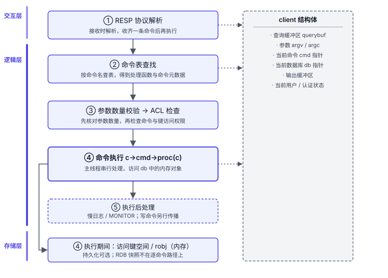
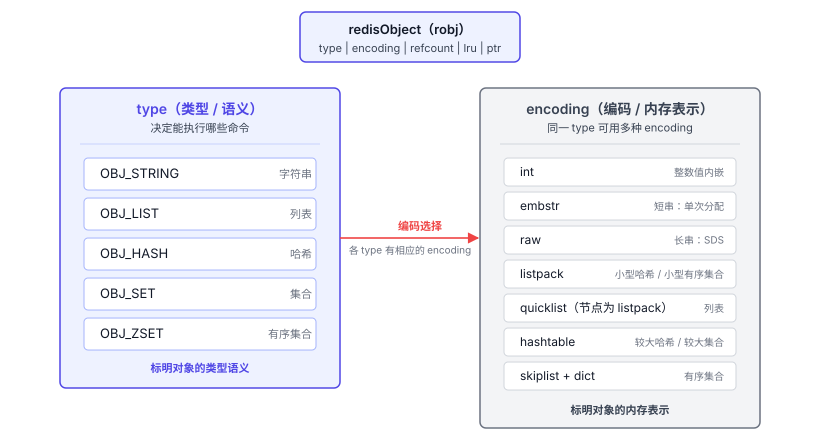
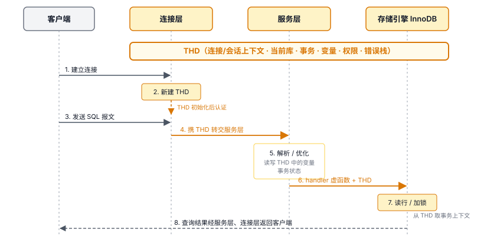
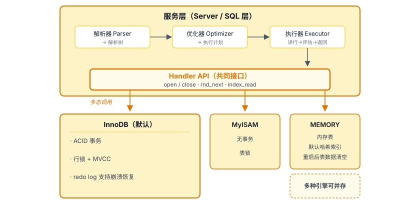
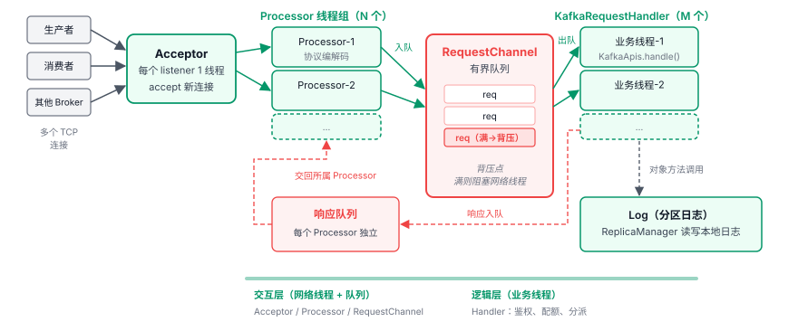
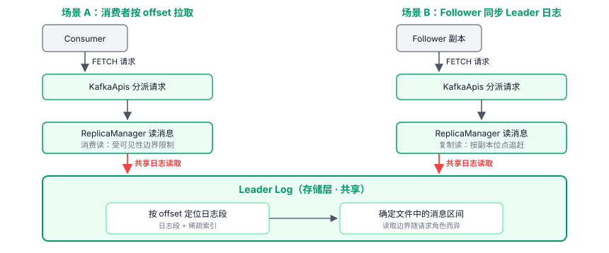
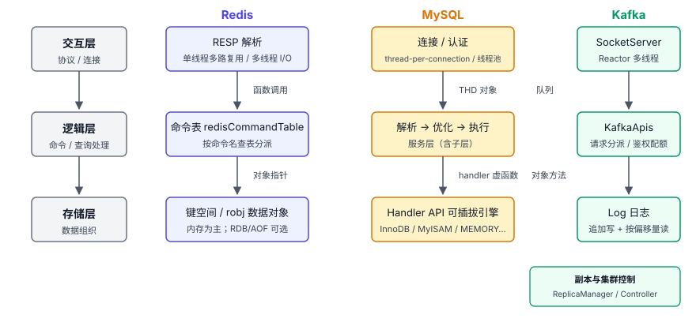

# 第 5 章 分层架构设计 — 存储层 / 逻辑层 / 交互层

## 本章导读

一个功能的需求变了，哪些已有代码会受到影响？运营后台的订单查询和导出若共用同一套 SQL 拼接逻辑，修改导出时就可能影响订单查询。如果这套逻辑把两种功能各自的需求混在一起，一次改动牵连的范围就会扩大。

网络交互、请求处理和数据存储之间也有类似的职责边界；一处变化会牵动多少环节，与这些边界怎样划分有关。

分层也有成本：多一层就多一处边界要维护，请求跨层还会有调用开销。本章从交互层、逻辑层、存储层三个方面，对比 Redis、MySQL、Kafka 的职责划分与层间通信。

## 5.1 分层要解决什么问题

一个把所有事情混在一起写的服务是这样的：直接监听 TCP，收到字节后就地解析命令、就地读数据库、就地拼成报文发回去。这种写法能让原型很快做出来。随着功能增多，问题会逐渐显现。一是修改请求处理流程时，常要同时理解协议、SQL 和内存模型，认知负担重；二是换网络库或升级存储格式会牵动多个处理环节，例如协议处理代码里可能还留着针对旧格式的假设；三是可测试性差，业务逻辑难以脱离网络做单元测试。

以数据读写请求为例，不可信的客户端输入先由交互层解析，再交给相应的逻辑与存储组件处理，结果经交互层返回。请求经过职责边界时，有时需要转换表示，层间调用也有开销；连接和会话状态则可能继续随请求传递。

这类读写路径在 Redis、MySQL、Kafka 中都能找到，各家要满足的约束不同，分层和调用方式也不同。

Redis 侧重**常见命令的低延迟**。它尽量让模块在进程内通过共享对象和函数调用衔接，减少额外的数据转换与线程交接。

MySQL 的约束是**SQL 语义 + 多种存储后端**。它把通用的 SQL 处理与具体存储引擎分开；事务型、内存型、归档型等引擎的能力和访问方式各有差异。为支持这些后端，MySQL 提供一套可插拔接口，让服务层通过统一接口访问不同的引擎实现。

Kafka 的分层还要适应**分布式部署**。Broker 与 Broker 之间、Producer 与 Broker 之间通过 TCP 通信；一个 Broker 内部的模块则可以用队列或对象方法调用衔接。Kafka 的分层需要兼顾内部职责划分与跨 Broker 协作，服务于水平扩展。

从功能职责看，三个软件都可以映射到交互层、逻辑层、存储层三段。

## 5.2 Redis 的做法

Redis 分出交互、命令处理和存储职责，常见命令通过进程内对象与函数调用衔接，请求路径较短。主线程中的事件循环衔接网络处理与命令执行；命令表负责分派，`redisObject` 用类型和编码分别表示数据语义与内存形式。

### 5.2.1 交互层：RESP 与单线程多路复用

Redis 与客户端之间用 RESP（Redis 序列化协议）通信。类型和长度信息使解析器能够**边接收边解析**，收齐一条命令并通过检查后再执行。

Redis 通过 Reactor 事件循环处理网络事件（Reactor 是事件驱动 I/O 模式的统称）。在 6.0 之前，Redis 的网络 I/O 和命令执行在同一个线程里：主线程用 epoll/kqueue 多路复用监听所有客户端连接，有事件就处理，处理完再回到事件循环。这套设计的关键是：交互层和命令逻辑在同一线程中衔接，不必为每次模块调用增加工作线程交接。数据结构可以保持串行访问，层与层之间主要传递对象和调用函数。

Redis 6.0 起可以选择启用多线程 I/O：网络收发等工作由多个线程分担，**普通命令仍由主线程串行执行**，键空间更新保留串行路径。

客户端输出缓冲区（client output buffer）暂存待发送的响应，让命令执行与后续网络发送分开。客户端接收得慢时，响应会在服务端积压，占用更多内存。

### 5.2.2 逻辑层：命令表与请求上下文

逻辑层用命令表组织命令。`redisCommandTable` 声明内置命令，将命令名关联到处理函数，并记录参数数量校验规则（arity）、命令是否只读、是否写入、是否可能阻塞等标志，以及键参数的位置规则。Redis 启动时把这些条目加入运行时命令表；收到请求后，再按命令名从中查找对应条目。

`client` 结构体把交互环节解析出的命令参数和会话状态带入命令处理环节，两个环节共享同一请求上下文。

图 5-1　Redis 命令处理流水线

图中的 `client` 保存查询缓冲区、命令参数和当前数据库等会话状态。多个处理环节按同一套字段约定使用这份上下文，无须逐层复制全部状态。

模块命令也可在加载时注册到运行时命令表，接入同一条分派路径。

### 5.2.3 存储层：数据对象、内存管理与持久化

Redis 围绕内存数据结构组织存储，没有像 MySQL 那样提供可插拔的存储引擎接口。

Redis 的数据对象由 `redisObject`（robj）统一表示。它把**类型（type）与编码（encoding）分离**：type 决定语义，表示对象属于字符串、列表、哈希、集合、有序集合等哪种类型，也决定了能对它执行哪些命令；encoding 决定内存表示。同一个 type 可以挂不同的 encoding，比如一个哈希在小数据量时用 listpack（紧凑连续内存），膨胀到阈值后自动升级为 hashtable。

图 5-2　redisObject 的 type 与 encoding 解耦

命令按 type 对外提供语义，例如对列表执行 LPUSH，内部编码变化不改这一语义。

达到 `maxmemory` 上限后，Redis 可拒绝会增加内存的写入，也可按策略淘汰已有键。大对象的释放也会影响请求延迟：`UNLINK` 可把释放工作交给后台线程；默认配置下，普通 `DEL` 可能在主线程同步释放大对象。

持久化也是可选的：RDB 保存全量快照，AOF 记录写入；两者都能关闭，此时实例只靠内存保存数据，重启即丢。

没有存储引擎接口的代价是，不能通过替换引擎，让同一套命令处理逻辑改用以磁盘为主的后端。

### 5.2.4 层间通信

Redis 这些进程内环节通过函数调用和共享对象衔接，不必为层间交互重新序列化数据。交互层到逻辑层走 `client` 结构体加直接函数调用；逻辑层到存储层走 `robj` 指针加直接内存访问。运行时命令表中的条目持有处理函数指针，分派时调用 `c->cmd->proc(c)`。进程内调用降低了常见命令的层间开销。

## 5.3 MySQL 的做法

MySQL 用同一套 SQL 服务支持多种存储引擎，因此在服务层与引擎之间设置了标准接口。`THD`（线程描述符，THread Descriptor）作为共享的会话上下文贯穿三层，服务层把 SQL 处理切成解析、优化、执行三段，存储引擎层用 Handler API 定义行操作契约。

### 5.3.1 交互层：连接、认证与线程模型

MySQL 的连接层负责客户端接入、协议握手和认证，也建立供后续处理使用的会话状态。服务层接收 SQL 请求时，无须区分底层连接方式。

常见的线程模型有两种。默认的 thread-per-connection 为每个连接分配独立线程；连接数多时，线程数随之增加，带来更多内存占用和调度开销。采用线程池时，多个连接通过排队和调度共用工作线程，减少每个连接各占一个线程的成本。

无论用哪种线程模型，MySQL 都有一个贯穿三层的对象：**`THD`**。每个连接创建一个 THD，里面存着这条连接在生命周期内需要的所有状态，包括当前库、当前事务、会话变量、权限位图、错误栈、字符集、临时表列表等。THD 会跟着请求穿过连接层、服务层、存储引擎层，每一层都在其中读写各自需要的字段。

图 5-3　MySQL 的 THD 会话上下文

Redis 的 `client` 与 MySQL 的 THD 都作为共享上下文跨层传递。THD 承载 SQL 执行和存储引擎所需的会话状态，MySQL 的三层因此依赖同一对象的字段约定。

### 5.3.2 逻辑层：查询处理的解析、优化与执行

MySQL 的逻辑层也称“服务层”（Server 层 / SQL 层）。以常见的查询处理路径为例，可以分成解析、优化、执行三个环节。

**解析器（Parser）** 先把 SQL 文本拆成词，再按语法规则建出解析树。预处理阶段检查表、列和权限，得到后续处理所需的查询表示。这一段还不决定具体怎样执行。

**优化器（Optimizer）** 接收查询表示，选择索引和 JOIN 顺序等策略，形成执行计划。

**执行器（Executor）** 取得执行计划后开始执行查询。以逐行执行路径为例：调用 handler 接口读一行 → 评估 WHERE 条件 → 聚合或返回 → 再读下一行。

服务层各阶段可通过进程内函数或方法调用衔接，传递结构化的查询表示和执行计划。

**查询缓存（Query Cache）** 曾在服务层按 SQL 文本复用 SELECT 结果。底层表发生修改时，服务层须使相关结果失效；跨服务层与存储层的协调，加上全局互斥锁，在高并发写入下可能抵消复用收益。MySQL 在 8.0 移除了这项功能。InnoDB 的缓冲池缓存的是数据页，与查询结果缓存承担不同工作。

### 5.3.3 存储层：Handler API 与可插拔引擎

MySQL 的服务层通过统一的 **Handler API** 向存储引擎发起表和行的访问，包括顺序扫描与索引读取。

实现这套接口的引擎可以接入同一服务层，各自支持的能力不同。InnoDB 是默认引擎，支持事务、行锁和崩溃恢复；MyISAM 不支持事务；MEMORY 把数据放在内存中，重启后表中数据丢失。已安装的引擎可以按表选择。

图 5-4　MySQL Handler API 与可插拔存储引擎

引擎通过接口向服务层报告自身能力和统计信息；数据组织方式和恢复能力则由具体引擎决定。

即使一个实例只用 InnoDB，Handler API 仍把服务层的 SQL 处理与引擎内部实现隔开。

### 5.3.4 层间通信

MySQL 的连接层与服务层通过 THD 对象和函数调用衔接；在默认的每连接一线程模型下，请求由连接线程继续处理。以 InnoDB 为例，服务层通过 handler 虚函数调用该引擎的实现。这两处层间调用在同一服务器内完成，无须跨机器通信。

## 5.4 Kafka 的做法

Kafka 的 Broker 既要在本机处理请求，也要与其他 Broker 协作。本节因此在交互、逻辑、存储三段之外，单列副本与集群控制的协调职责。

### 5.4.1 交互层：SocketServer 与 Reactor 多线程模型

Kafka 的请求处理路径包括 Acceptor、Processor、RequestChannel、KafkaRequestHandler 四个主要环节。RequestChannel 是线程间传递请求与响应的通道；KafkaRequestHandler 对应第 3 章的 Handler 线程池。

每个监听端点（listener）对应一个 **Acceptor** 线程，主要负责接收新连接。它用 Java NIO 的 Selector 监听服务端 socket，收到连接后按轮询策略交给某个 Processor。

**Processor 线程组**的大小可配置，每个 Processor 线程管理一批连接的网络读写和请求解析。它把客户端发来的字节流按 Kafka 协议解析成 `Request` 对象，写入 RequestChannel 的请求队列。响应经 RequestChannel 转交给对应 Processor 的独立响应队列，再由该 Processor 写回客户端。

**RequestChannel** 是 Processor 与业务线程之间的交接点，内部的请求队列是一个**有界阻塞队列**。它有界是关键：当业务线程处理不过来、请求队列填满时，Processor 的入队操作会阻塞，进而阻塞该线程的网络 I/O。这是一个天然的背压（backpressure）点，限制请求在这条队列中积压。

**KafkaRequestHandler 线程组**的线程数由 `num.io.threads` 配置，每个线程从 RequestChannel 里取请求，调用 `KafkaApis.handle()` 处理。

图 5-5　Kafka 请求处理线程模型

Redis 即使启用多线程 I/O，普通命令仍由主线程串行执行；Kafka 则由网络线程组负责收发，由业务线程组处理请求。

### 5.4.2 逻辑层（API 层）：请求类型分派

交互层交给 `KafkaApis` 的请求按 ApiKeys 区分类型，各类请求有自己的协议版本。`KafkaApis.handle()` 接收 `RequestChannel.Request`，分派给相应的处理方法；这一环节还涉及鉴权、配额等请求级工作。

日志读写、副本管理、消费组协调和集群控制分别由 `Log`、`ReplicaManager`、`GroupCoordinator`、`Controller` 等组件承担。客户端协议版本与副本机制不必同步演进，分开这些职责可以限制修改范围。

### 5.4.3 存储层：Log 抽象 + 零拷贝

Kafka 的核心存储抽象是分区日志：每个分区副本有自己的 Log，由多个日志段组成，每段包含消息数据和用于定位消息的索引。

**写入时，Broker 把消息批追加到活跃日志段。**Log 层组织日志文件与索引，日志刷盘把页缓存中的数据同步到存储设备。

**读取路径**先按偏移量找到对应日志段，再用段内的稀疏索引找到邻近的文件位置，继续查找目标消息批。找到目标消息批后，Broker 确定本次响应对应的文件区间，交给发送路径。如果所需数据已经在页缓存里，就无须再从存储设备读取。

以明文连接发送本地日志，且发送前无须改写文件数据时，Kafka 可以用 Linux 的 `sendfile` 系统调用，让文件数据从页缓存进入 socket 的发送路径，省去经用户态缓冲区的往返拷贝。

消费者和 Follower 都通过 FETCH 请求读取分区日志。

图 5-6　Kafka 消费与复制的日志读取复用

底层日志读取路径可以复用，索引、缓存和文件读取的优化能同时惠及消费与副本同步；副本进度、任期和截断由复制逻辑处理。

**Kafka 用追加日志作为基础存储抽象，日志存储组件负责索引与压实，副本协调则由上层组件负责**。它没有提供 MySQL 式的引擎插件接口，系统各层都依赖“Log 是顺序追加、按偏移量寻址”这一核心抽象。

Tiered Storage 可以把已完成的日志段放到对象存储等远程后端，存储从本地扩展为本地和远程两级。客户端仍通过 Kafka 按偏移量读取日志，Broker 内部则增加了远程日志管理与读取处理，远程存储后端通过 RemoteStorageManager 接口接入。

### 5.4.4 副本与集群控制的协调职责

Kafka 还要管理分区的 Leader、ISR（同步副本集合）和集群元数据。Broker 内的 `ReplicaManager` 管理副本，`Partition` 表示分区；`Controller` 负责集群控制，在 KRaft 模式下可以独立于 Broker 进程部署。这些协调职责与请求分派和日志读写不同。

### 5.4.5 层间通信

在同一 Kafka Broker 内，交互层到 API 层经 RequestChannel 队列跨线程交接；API 层处理请求时，通过对象方法调用本 Broker 的 Log、ReplicaManager 或 Partition 等组件，无须网络传输。Broker 之间、独立部署的 Controller 与 Broker 之间则通过网络协议通信。例如 ReplicaManager 管理的 Follower 副本拉取线程从另一台 Broker 的 Leader 拉数据。

## 5.5 横向对比

三个软件都分层，职责划分和跨边界调用的方式不同。

图 5-7　三个软件的分层职责对照

两处边界最能说明三者分层形态的差异。

**第一，存储引擎的能力差异影响可插拔接口的取舍。** Redis 以内存数据结构为核心，没有提供 MySQL 那样的可插拔引擎接口。MySQL 要支持事务型、内存型、归档型等引擎，因此用统一接口隔离不同引擎的实现。Kafka 的存储围绕追加日志组织，消费与副本同步复用同一底层日志读取路径。它没有提供 MySQL 那样的通用引擎替换接口。

**第二，通信机制受部署边界影响。** Redis 的模块间、MySQL 同一实例内的服务层与引擎间通过进程内调用衔接；Kafka 在同一 Broker 内有线程间队列交接和对象方法调用，跨 Broker 则使用网络协议。边界从进程内扩展到跨机器，需要承担协议与传输开销。

## 5.6 架构启示

### 启示一：边界的收益与调用成本要一起衡量

职责边界不必同时成为线程或进程边界。Redis 用命令表把分派逻辑与具体命令实现分开，新增普通命令无须改写分派逻辑，分派后通过函数指针在进程内调用处理函数。若在这条命令处理路径上增设线程间交接或进程间通信，额外开销会随命令执行次数累积。

### 启示二：稳定接口约定支持内部演进

Redis 的 type/encoding 分离让内部编码可以变化，而命令语义保持不变。Kafka 的消费与副本同步共用按偏移量读取分区日志的底层约定；在保持这一约定的前提下，底层索引、缓存和文件读取的优化可以同时惠及两者。若约定改变，两者都需要适配。

### 启示三：替换需求决定可插拔设计

不是每一层都要可插拔。MySQL 要让不同存储引擎共用服务层，便通过 Handler API 规定行操作；引擎各自组织数据，支持的恢复能力也不同。服务层的通用 SQL 处理流程可以复用，具体的优化和执行仍受引擎能力约束。

是否提供可替换接口，要看实现是否真需要替换，以及维护这份契约是否值得。

### 启示四：分层需要独立职责与单向依赖

第一类问题是**没有独立职责的透传层**。如果 Service、Manager、Dao、Mapper 连续几层都把参数原样传下去，就只是增加认知负担和调用链长度。统一入口、路由、隔离后端、鉴权、限流或转换都可以构成独立职责。

第二类问题是**循环依赖**：A 层依赖 B 层，B 层又依赖 A 层。修改 A 层时需要同时考虑 B 层，反过来也一样，两个层的修改被耦合在一起，难以通过分层把变化限制在局部。

## 5.7 小结

Redis 的分层控制请求路径的开销，MySQL 为真实的替换需求保留接口，Kafka 则按功能职责、线程交接和跨机器通信分别划定边界。

下一章沿请求链路和存储路径讨论认证、授权、加密与审计，第 7 章再展开 Kafka 的副本与集群控制、Redis Cluster 的槽路由和 MySQL MGR 的多数派。
