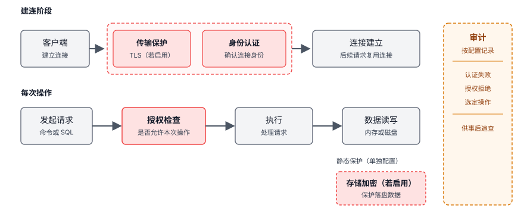
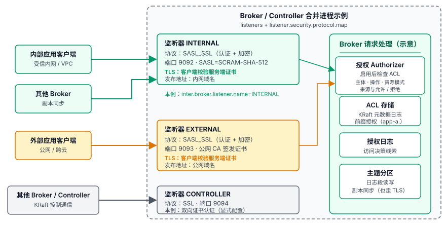
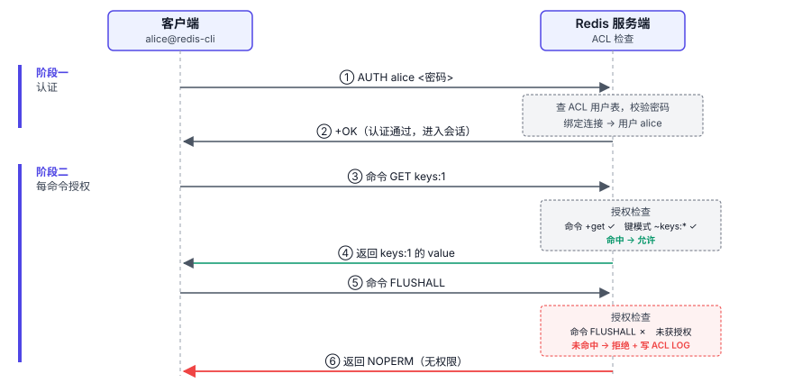
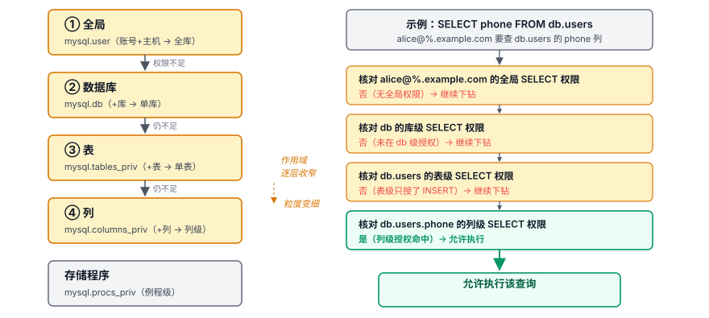

# 第 6 章 安全机制 — 权限、加密、审计

## 本章导读

允许无认证访问的 Redis 实例若将 6379 端口直接暴露到公网，扫描程序就可能连接并写入数据。测试环境也存在这种风险。

安全设计涉及四件事：谁能进入、能访问什么、传输和落盘的数据怎样得到保护，以及事后能否追查。Redis、MySQL 和 Kafka 管理的资源、允许的操作和请求经过的连接路径不同，安全控制要覆盖的范围也不同。

## 6.1 问题的本质

认证、授权、加密和审计提供了四个检查维度。

第一个是**认证（Authentication）**，确认访问者的身份。

第二个是**授权（Authorization）**，界定已认证身份能对哪些资源执行哪些操作。权限粒度要能表达所需的隔离边界；规则过细也会增加维护成本。

第三个是**加密（Encryption）**，分为传输加密和存储加密：传输中通常由 TLS 的加密与完整性校验保护数据，存储加密则降低磁盘丢失时的数据泄露风险。

第四个是**审计（Audit）**，对应的问题是“事后能否查清谁在什么时候做了什么”。审计记录是合规取证和事后复盘的依据。

图 6-1 示意各项措施启用后，安全控制在连接、操作、落盘和审计环节中的位置。


图 6-1　安全控制点示意

这类系统常用长连接处理频繁的小操作。如果每次操作都重新完成认证握手，开销会反复产生，因此通常在建连时认证，再按操作检查权限。共享实例承载多个应用时，授权还要区分各自可访问的键、表或主题。复制与协调连接则要确认节点身份，不能只保护客户端入口。

## 6.2 认证

### 6.2.1 Redis：从全局密码到 ACL 用户

6.0 之前的 Redis 只有 `requirepass` 全局密码。启用后，所有客户端共用一份口令，服务端无法按调用者区分权限；口令一旦泄露，也难以只撤销其中一个客户端的访问。

6.0 引入 ACL（Access Control List，访问控制列表），补上了按用户分别管理凭证和权限的能力。ACL 以“用户”为核心，每个用户有自己的密码集合、命令权限和键模式。

以新用户 alice 为例，在 redis-cli 中执行（pwd 为密码占位符）：

```redis
ACL SETUSER alice on >pwd ~keys:* +get +set
```

这条语句创建并启用用户 alice，以 `>pwd` 设置密码，允许访问匹配 `keys:*` 的键，并授予 `GET` 和 `SET` 命令权限。

### 6.2.2 MySQL：可插拔认证插件是核心抽象

MySQL 的用户身份由 `用户名@主机名` 两部分组成。同一用户名可以对应不同的来源范围，各自形成独立账号，分别配置密码和权限。这适合区分应用网段、办公网和跳板机等来源。

MySQL 从 8.0.4 起把默认认证插件从 `mysql_native_password` 改成了 `caching_sha2_password`。缓存未命中时，服务端通过安全连接或 RSA 加密的密码交换完成完整认证，并在内存中缓存认证信息；后续连接命中缓存时，走挑战—响应的快速认证路径。改密码、重启等事件会清除相关认证缓存。

认证插件还让验证方式可以替换：`auth_socket` 根据 Unix socket 对端的操作系统身份认证本地连接；企业版的 `authentication_pam` 和 `authentication_ldap_simple` 分别接入 PAM 与 LDAP。这与第 5 章的可插拔存储引擎类似：服务端保留扩展接口，将不同身份来源的验证逻辑交给相应插件。

### 6.2.3 Kafka：分监听器配置认证

Kafka 集群中的连接包括客户端到 Broker 的连接、Broker 之间用于副本同步的连接，以及 Broker 到控制面的连接。以下以 Kafka 3.6 的 KRaft 模式为例：连接可以用 SASL（Simple Authentication and Security Layer，简单认证与安全层）认证，也可以通过 TLS 客户端证书认证。

同一个 Broker 可以开多个监听器，按连接来源分别配置认证和加密。图 6-2 以 Broker 与 Controller 合并进程示意三类连接：内部和外部监听器配置为 `SASL_SSL`，控制面监听器配置双向 TLS。


图 6-2　Kafka 多监听器配置

多个监听器分别使用各自的协议和端口，启用 TLS 的路径还要管理相应证书。Broker 对外地址、控制面端点需要与实际连接路径对应，多监听器也因此增加了配置维护与核对的工作。

SASL 支持 PLAIN、SCRAM、Kerberos 和 OAuth 2.0 等认证机制。Broker 和客户端通过 JAAS（Java Authentication and Authorization Service）配置所选机制。这样可以接入不同身份系统，而不用为每种方式另起一套认证协议。

## 6.3 授权

### 6.3.1 Redis：命令、键与通道权限

Redis 不做 RBAC（基于角色的访问控制），而是将权限直接分配给用户。用户和权限关系简单时，这样容易管理；关系复杂后，要承担重复授权和统一维护的成本。对键的访问要同时满足命令权限和键模式约束。

命令既可逐条授权，也可按类别授权。Redis 提供 `@read`、`@write`、`@admin`、`@dangerous` 等语义组，以及 `@fast`、`@slow` 等性能组。在未授予其他命令权限的用户上，`+@read -@dangerous` 可作为只读命令权限片段。按类别授权减少了逐条列举命令的工作。

多租户按前缀隔离时，键模式负责限制数据读写，命令权限负责限制键名枚举和全库操作。GET、SET 等命令声明了键参数，因此可用 `~keys:*` 限定允许访问的键；SCAN 返回的键名不按该前缀过滤，没有键参数的全库操作也不受键模式限制。


图 6-3　Redis ACL 认证与授权时序

Redis 6.2 起，ACL 可把 Pub/Sub 通道的发布、订阅权限与键空间读写权限分开配置。

### 6.3.2 MySQL：多层级权限表加 8.0 RBAC

MySQL 的权限覆盖全局、数据库、表、列和存储程序几种作用域。检查表或列的访问权限时，先看全局授权，再看数据库、表和列等范围的授权；存储程序权限对应另一类对象。


图 6-4　MySQL 表列权限检查路径

权限检查随语句执行反复发生。MySQL 在启动时把授权表载入内存，后续检查使用内存中的授权信息，省去逐次查询授权表的开销。

MySQL 8.0 引入角色系统，支持 `CREATE ROLE`、`GRANT role TO user` 和会话级 `SET ROLE`。角色把一组权限交给多个账号复用；可以按默认设置在登录时激活，也可以在会话内切换。

### 6.3.3 Kafka：ACL 关联主体、操作与资源

Kafka 的内置授权器用 ACL 表达权限。规则涉及主体（Principal，通常是服务账号或用户）、操作（Operation）与资源模式（Resource Pattern），还可限定来源主机，并标记允许或拒绝。资源可以是 Topic、Group、Cluster 等，操作可以是 Read、Write、Create 等。只有显式启用 Authorizer，ACL 才会参与请求授权。

内置 ACL 不提供角色模型；权限关系复杂时，可以统一管理规则，或通过可替换的 Authorizer 接口接入其他实现。

当主题以稳定前缀划分归属时，前缀资源模式可让 `app-a.` 开头的一组主题共用授权规则，减少逐主题配置。如果同一前缀下包含权限范围不同的主题，就不能仅按这个前缀统一授权。

## 6.4 加密

三个软件都支持用 TLS 保护传输，启用位置与配置方式不同。

### 6.4.1 Redis：TLS 到 6.0 才原生支持

Redis 6.0 之前，stunnel 代理或 SSH 隧道在外部进程中完成传输加密，Redis 核心无需实现 TLS。原生 TLS 把加解密计算放到 Redis 服务进程内，部署时可以减少一个外部组件。

Redis 的 TLS 可选，按端口开启：可以关闭明文端口、只开 TLS 端口，也可以让两者并存做平滑迁移。TLS 会增加加解密和完整性校验的开销；短连接频繁握手还会增加认证与密钥协商开销。

### 6.4.2 MySQL：传输 TLS 加存储 TDE 两层

MySQL 也用 TLS 保护连接；账号级 `REQUIRE SSL` 只要求指定账号使用加密连接。加密之外还要确认对端身份：客户端校验服务端证书及主机名，确认服务端身份；在此基础上，`REQUIRE X509` 要求服务端也验证客户端证书，实现双向证书认证。

原生存储加密是 MySQL 与另外两款的一个差别。TDE（Transparent Data Encryption，透明数据加密）在 InnoDB 表空间级别加密数据，密钥由 keyring 组件或插件托管。应用 SQL 无需改动，加解密在存储引擎层完成。表空间加密不覆盖所有日志，redo log、undo log 与 binlog、relay log 各有独立的加密设置。密钥丢失会使数据不可读，因此需要可恢复的密钥备份。


### 6.4.3 Kafka：按监听器配置 TLS

Kafka 在建连时完成 TLS 握手。多批数据可以复用同一条长连接，握手开销由这些传输分摊，加解密则在每批传输时执行。不同监听器可以分别配置证书，管理内部与外部连接的信任关系。

部署 Redis 和 Kafka 时，可通过部署层的存储加密保护落盘文件，并管理相应密钥。

## 6.5 审计

前三部分讨论如何限制访问和保护数据，审计对应的问题是事后能否追查。记录范围越广，采集、存储和检索的成本也越高。

Redis 的 ACL LOG 在内存中保留近期的认证失败和权限拒绝事件，便于排查访问问题；长期追查需要将记录保存在外部。SLOWLOG 记录慢命令，不能充当业务审计流水。

MySQL 企业版提供审计插件，可按用户、数据库或主机过滤语句级事件，并写入审计日志文件。社区版自带的 General Log 可记录客户端发来的语句，适合短时排查；持续开启会增加 I/O 和存储成本。

启用 Authorizer 后，Kafka 的授权日志（`kafka.authorizer.logger`）提供访问决策线索，不包含消息内容。客户端拦截器可补充记录发送和消费的业务事件；追查业务动作时，需要将这些线索与服务端记录结合。

异步采集审计事件可以减轻请求链路上的写入开销。采集失败时可能丢失记录，因此，对要求完整留存的关键安全事件，采集链路需要具备失败恢复能力；性能诊断日志则可以采样。

## 6.6 横向对比

表 6-1 对照三款软件的身份、权限、数据保护和审计能力。

**表 6-1　安全机制横向对比**

| 对比维度 | Redis（7.x） | MySQL（8.0） | Kafka（3.6，KRaft） |
|---|---|---|---|
| 连接身份 | ACL 用户 | `用户名@主机名` | Principal（由 SASL 身份或客户端证书映射） |
| 授权依据与范围 | ACL 用户的命令、键与通道规则 | 账号及激活角色的库、表、列等权限 | 启用 Authorizer 后的主体、操作与资源模式规则 |
| 传输加密 | 可选 TLS 端口 | TLS；账号可要求 `REQUIRE SSL` | 各监听器分别配置 TLS |
| 静态数据保护 | 无原生落盘加密，可借助外部加密 | 表空间可加密；相关日志独立配置 | 无原生落盘加密，可借助外部加密 |
| 原生审计线索 | ACL LOG 保留近期认证失败与权限拒绝 | 企业版审计插件；社区版 General Log 仅供有限排查 | 启用 Authorizer 后的授权决策日志，不含消息内容 |

## 6.7 架构启示

### 启示一：纵深防御要覆盖实际的失效路径

网络边界失效后，已启用的认证需要覆盖实际可达的连接，授权需要覆盖相关操作，才可能阻断越权。预防控制未能拦住访问时，只有相关事件被记录并留存，审计才能为事后追查提供线索。

### 启示二：授权能力约束隔离方案

Redis 的键模式只约束命令声明的键参数，不能按前缀过滤 `SCAN` 返回的键名。如果隔离要求还包括隐藏其他租户的键名，单靠键前缀就不够：可以不授予该身份枚举命令，或取消客户端直连，让请求只经过另设授权检查的应用接口。当授权规则无法识别需要隔离的对象时，调整资源组织或另设检查就成为隔离方案的一部分。

### 启示三：下游授权需求决定身份传递方式

连接上的认证只确认当前连接使用的身份。跨服务调用时，如果下游只认证服务账号，它看到的就是服务身份，无法直接识别最初的调用者。Kafka 3.6 的 KRaft 模式下，Broker 转发部分管理请求时带上原客户端 Principal，Controller 分别检查 Broker 的转发权限和该客户端对目标资源的权限。下游需要识别原始调用者时，调用链就需要提供可验证的身份传递方式。

### 启示四：认证设计要考虑身份来源与凭证撤销需求

MySQL 用认证插件接口接入不同的验证方式：Unix socket 本地连接可以使用操作系统身份，企业版还可通过插件接入 PAM 或 LDAP。认证方式是否需要这样的替换能力，要看系统实际对接和更换身份源的需求；身份源简单且稳定时，引入复杂框架未必划算。凭证撤销则与凭证的分配方式有关：多个服务共用一个全局密码，就很难单独撤销其中一个服务的凭证。

## 6.8 小结

判断安全设计是否覆盖需要防范的风险，要同时考虑数据模型、请求经过的边界、部署与配置；脱离这些条件谈“谁更安全”没有意义。

下一章进入集群架构：分片怎么切、副本怎么保持一致、故障后怎么自动转移、元数据谁说了算。
