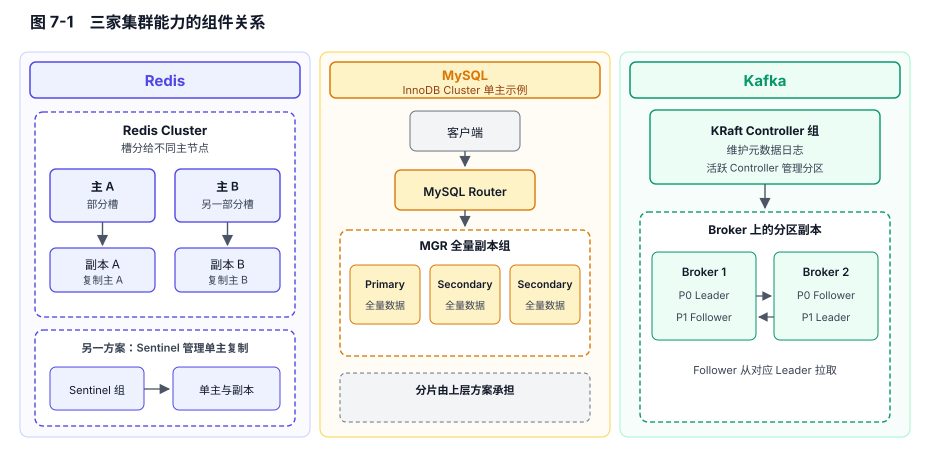
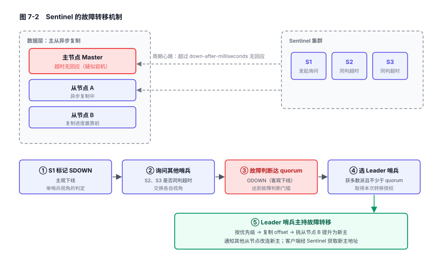
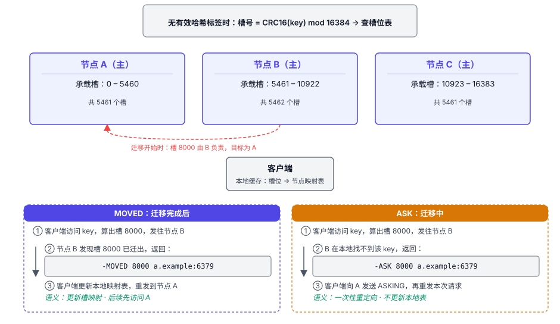
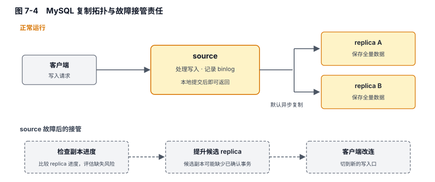
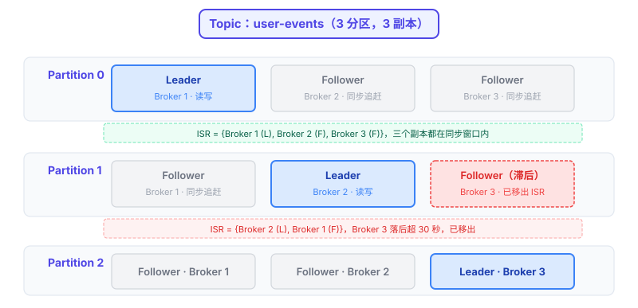
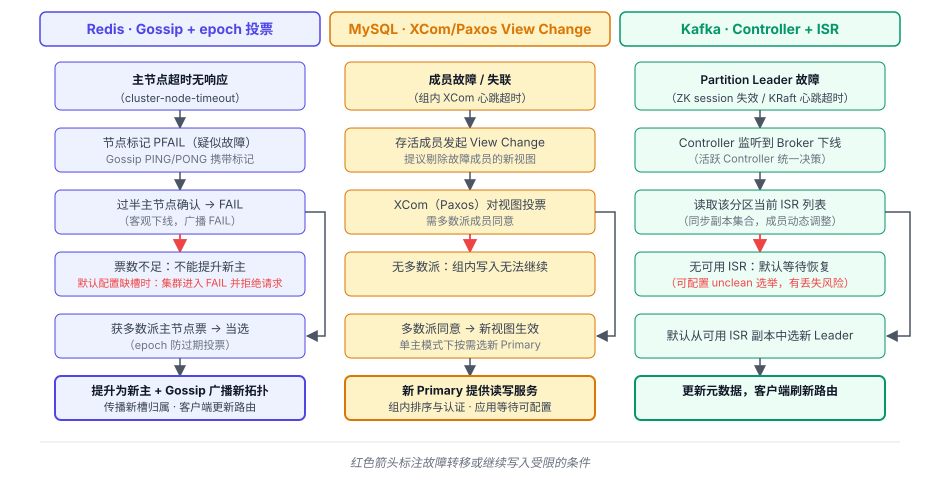

# 第 7 章 集群架构 — 从单点到分布式

## 本章导读

业务跑顺了，流量却开始翻倍。一台机器终会遇到 CPU、内存或磁盘的上限；它一旦宕机，服务也可能随之中断。集群把数据和服务分布到多台机器上。扩容与故障接管是两项不同的任务。

Redis、MySQL、Kafka 都要处理数据分布、副本和故障转移，区别在于哪些能力由软件提供，哪些留给使用者组合。

假设一个库存服务用 Redis Cluster 保存扣减结果。网络分区触发主从切换时，少数派老主在超时判定前仍可能接收写入；尚未到达新主的扣减，在网络恢复后可能丢失，造成库存超卖。评估自动故障转移，需要核对少数派何时停写，以及新主能否保留已确认的库存扣减。

## 7.1 问题的本质

Redis 内存不足时，增加一个从节点能扩大数据容量吗？

加从节点，是把同一份数据保存到其他机器上，形成复制（replication）。主节点宕机后，可以由从节点接管，缩短服务中断的时间；每个副本都保存全量数据，主节点内存不足的问题并没有解决。

要扩大数据容量，需要把数据切开放到不同机器上，每台只存一部分，这叫分片（sharding，也叫 partitioning）。分片和复制可以独立选择：只分片不复制，容量增加了，一台机器故障就会使它负责的数据无法访问；只复制不分片，则只增加副本，不增加可保存的数据量。需要同时扩容和容错时，两者可以结合，分别承担数据分布和故障接管的任务。

单机还有一条与数据量无关的上限：**单节点吞吐瓶颈**。分片后，各节点承担自己负责的那部分流量。即便数据量不大，每个节点的网络带宽、磁盘 IOPS（每秒 I/O 操作数）也可能成为吞吐上限。热点集中在一个分片时，它所在的节点可能先达到吞吐上限。

采用分布式部署后，会带来四个新的问题。

**第一，数据怎么切。** 是按范围切（如 0–999 在节点 A、1000–1999 在节点 B），还是按哈希切（`hash(key) % N`）？按范围分片便于范围查询，也更容易遇到访问热点；简单按节点数取模，通常能分散键。

节点数改变后，取模方案中大量键的落点也会变化。扩容时重新分布数据带来的迁移成本和影响，也决定了集群能不能平滑扩展。

**第二，副本怎样保持一致。** 主节点写入后，要不要等从节点确认再向客户端返回成功？等副本，用延迟换取故障时更高的数据保留概率；不等，刚确认的写入可能还没有到达接管的新主。副本确认的是收到数据还是持久化，故障后如何选择新主，都影响最终的数据一致性。

**第三，故障怎么发现与转移。** 一个节点多久没心跳算“掉线”？是单个节点就能确认，还是收集多个节点的意见后再确认？选新主按什么规则（优先级、日志进度、ID）？分区时少数派该怎么办：继续写（可能脑裂：两个主各自接受写入、数据分叉）还是停服（宁可不可用）？

**第四，元数据怎么管理。** 哪个节点承载哪些分片？谁是当前的主？副本同步到哪了？这些元数据（metadata）由谁维护、怎样传播？Kafka 由 Controller 协调，MySQL 组复制通过组通信维护成员视图，Redis Cluster 用 Gossip（节点间交换并传播状态）传递节点与槽信息。

这四个问题之上，还有一条约束：**CAP 定理**。当网络分区（Partition）使节点之间无法通信时，系统不能同时保证原子一致性（Consistency）和所有非故障节点上的请求都能得到响应（Availability）。这里的一致性要求操作表现得像在一个节点上按顺序完成，并保留真实时间先后。下文重点比较分区时哪些请求还能执行，以及已确认数据在故障转移时如何保留。

图 7-1　Redis、MySQL、Kafka 的集群能力与责任边界。

## 7.2 Redis 的做法

### 7.2.1 主从复制：高可用的基础

Redis 最基础的复制拓扑是一个主节点带若干从节点。在从节点执行 `REPLICAOF host port`，即可指定上游。首次同步先取得快照，再补上期间的写入；短暂断线后，条件满足时可以只补差量。

从节点可以分担读取，并为主节点故障后的接管保存一份数据。复制默认是**异步**的：主节点不等从节点确认便返回，刚确认的写入可能来不及复制。这种拓扑不分摊主节点写入，也不扩大数据容量。主节点故障后，需要人工提升从节点并调整复制关系。

### 7.2.2 Sentinel：把人工故障转移自动化

Sentinel（哨兵）负责自动故障转移。Sentinel 本身是一组独立进程，它们监控主从节点。每个 Sentinel 周期性地给主从节点发心跳；超过 `down-after-milliseconds` 没回应，它就把主节点标记为**主观下线**（SDOWN，subjectively down），这是单个 Sentinel 的判断。随后它询问其他 Sentinel；认为主节点下线的 Sentinel 数量达到配置的 quorum（人工设定的判定票数），才标记为**客观下线**（ODOWN，objectively down）。

接下来，Sentinel 选出一个 Leader 主持转移；授权票数既要达到多数派，也不能低于配置的 quorum。随后按优先级、复制偏移量（offset）、runid（实例每次启动时随机生成的运行 ID）三个维度，挑选一个从节点提升为新主，并通知其他从节点改连新主。

图 7-2　Sentinel 故障转移机制：心跳超时后，Sentinel 先将主节点标记为主观下线；故障判断达到 quorum 时，再标记为客观下线，随后选出获多数派授权的 Leader 哨兵主持转移。

达到 quorum 的下线判断与 Leader 的多数派授权是两道门槛，约束的是故障判断和转移决策。节点宕机或网络分区都可能触发转移。主从数据采用异步复制，新主未必保留原主刚确认的写入。

Sentinel 要求客户端从它那里获取当前主节点地址。Redis Cluster 则把分片与自动故障转移结合起来。

### 7.2.3 Redis Cluster：分片加自动容错，去中心化元数据

Redis Cluster 在 key 与节点之间加入了 **16384 个槽（slot）**：key 先映射到 0–16383 的槽，再由槽映射到节点。每个主节点承载一组连续或不连续的槽。如果直接按 `hash(key) mod 节点数` 分布数据，节点数一变，大量 key 的落点就可能改变；槽的数量固定后，增加节点只需把部分槽从老节点迁移到新节点，大部分 key 不动。16384 个槽对应 2KB 的槽位 bitmap；槽太少会让迁移粒度过粗，太多则增加状态传播开销。

没有哈希标签（hash tag）时，槽号按 `CRC16(key) mod 16384` 计算；key 含有效的非空 `{...}` 标签时，只对括号内内容计算 CRC16。Redis Cluster 要求多键命令（如 `MGET`、事务、Lua 脚本）涉及的所有 key 落在同一个槽，相同标签可以满足这一条件。例如，`{user:1001}.name` 和 `{user:1001}.email` 就会落在同一槽。

图 7-3　Redis Cluster 16384 槽分布与 MOVED/ASK 路由：槽是 key 到节点的中间抽象，迁移只移动部分槽，大部分 key 不动。

客户端可以缓存槽到节点的映射，让绝大多数请求直接到达目标节点。扩容、缩容或故障转移改变了槽归属时，节点可以返回 MOVED 重定向，客户端据此更新本地映射，后续请求使用新地址。

槽正在迁移时，节点也可能返回 ASK 重定向，让这一次请求先到临时目标执行。客户端先向目标节点发送 `ASKING`，再发送本次请求，暂不更新槽映射；后续请求仍先访问原节点，迁移完成后的新归属由 MOVED 通知。

**元数据分散维护，用 Gossip 传播状态。** Redis Cluster 没有集中的协调者，节点通过集群总线交换槽归属、成员和故障信息。各节点视图在传播过程中可能暂时不同，客户端也可能暂时持有过期映射。

**容错靠从节点发起选举。** 当主节点被判定下线后，符合条件的从节点向其他主节点请求转移授权，获得多数主节点的票后提升为新主，接管原主的槽。epoch 用来区分选举和配置的新旧，新的槽归属再向其他节点传播。多数派授权决定谁接管。业务数据采用异步复制，原主刚确认的写入若尚未到达新主，转移后可能丢失。

少数派主节点失去与多数派的联系后，会在 `cluster-node-timeout`（默认 15 秒）触发的超时判定后停止写入；检测到分区之前仍可能接收写入。开头库存场景中，在这个时间窗口内写到少数派老主并得到确认的扣减，也可能在转移后丢失。多数派一侧也需要为不可达的主节点找到可晋升副本，恢复槽覆盖。默认要求所有槽都有节点负责，缺槽期间整个集群会停止服务；配置为允许部分槽服务时，多数派一侧可以继续处理由可用主节点负责的槽。

## 7.3 MySQL 的做法

MySQL **主从复制**由主节点（source）处理写入、记录 binlog，从节点（replica）接收并回放变更。每个从节点保存全量数据。复制默认是异步的：主节点提交后不等从节点便返回，切换到落后的从节点时，可能失去已确认事务。

图 7-4　MySQL 复制拓扑与故障接管责任。

### 7.3.1 异步复制与换源：GTID 简化进度对齐

启用全局事务标识（GTID，Global Transaction Identifier）后，每笔事务都有可识别的标识。从节点切换复制源时，可以用 GTID 集合对齐新旧复制源的事务进度，减少人工对齐日志文件和位置的工作。

从节点接收日志后，还要在本地回放，接收进度与回放进度可能不同。回放落后时，读取可能看到旧数据，故障转移也不能只凭日志接收进度判断候选新主的状态。

### 7.3.2 半同步复制：在异步与全同步之间

半同步复制（semi-sync replication）在异步复制上增加了副本确认：主节点至少等一个从节点接收并记录事务日志，再向客户端返回成功。确认超时可能降级为异步。半同步改变写入确认条件，不负责选主；切换时必须选中持有已确认事务的副本，才能在新主上保留它们。

### 7.3.3 Group Replication

组复制（MGR，MySQL Group Replication）在组内协调事务顺序，底层使用基于 Paxos（一种多数派共识协议）的组通信组件 XCom。以单主模式为例，主节点提交事务前，组内成员按共同顺序对写集（事务改动行的标识）做冲突认证；认证通过后，主节点提交并返回成功，其他成员随后应用这笔事务。

XCom 需要多数派成员才能继续作出决定：3 个成员能容忍 1 个故障，5 个能容忍 2 个。成员故障或加入会触发 View Change（视图变更），组内随之更新成员视图。网络分区后无法联系多数派时，MGR 无法继续确认新的组内写入。

MGR 有两种模式。**单主模式（single-primary）** 是默认模式：组里只有一个主节点（Primary）可写，其他从节点（Secondary）只读，主节点故障时组内自动选新主。**多主模式（multi-primary）** 允许所有成员都可写，写入要在组内做冲突认证（Certification）：比较并发事务的写集，检查是否修改了同一行；冲突时，全序（组内统一认定的事务顺序）中排在前面的事务获胜，另一个事务在发起节点回滚。多主模式需要承担额外的写冲突和回滚开销。

事务经多数派协调后，其他成员可能尚未应用完毕。MySQL 8.0 默认的一致性级别为 `EVENTUAL`，跨成员读取可能暂时看到旧数据，额外的等待由 `group_replication_consistency` 控制。跨节点通信和等待都可能增加事务延迟。

### 7.3.4 MGR 不分片

MGR **不分片**，每个成员都持有**全量数据**。新增成员增加副本数，不会扩大单表容量，故障容忍度受多数派门槛约束。单主模式由一个主节点处理写入；多主模式允许多个成员接收写入，每个成员都要认证和应用全组事务，不能按分片方式扩展写入。

MySQL 把副本组交给 MGR，数据分片则由 ShardingSphere、Vitess、MyCAT 等上层方案承担。需要同时扩充容量和提高可用性时，还得设计各分片的复制与故障转移。组合空间更大，集成与运维责任也更多地留给使用者。

### 7.3.5 InnoDB Cluster：把组件打包成方案

MGR 负责副本组和组内选主，MySQL Router 则向客户端提供统一的连接入口。Router 读取集群拓扑，把读写连接路由到主节点，把只读连接按策略路由到相应成员。主节点切换后，新的连接可以路由到新主。

MySQL Shell 提供建组、加成员和查看状态等运维管理功能，与 MGR、MySQL Router 一起构成基于全量复制的 InnoDB Cluster，降低了使用复杂度。

## 7.4 Kafka 的做法

Kafka 围绕分区组织数据，主题的多个分区与副本可以分散到多台机器上。每个分区有一个 Leader，可以配置若干 Follower；写入由 Leader 处理，消费者默认也从 Leader 读取，Follower 从 Leader 拉取数据。

图 7-5　Kafka 分区与副本拓扑：Partition 是并行单位，每个分区一个 Leader 加若干 Follower，Leader 分散在各 Broker。

### 7.4.1 Partition：分区即并行单位

一个主题（topic）被切成 N 个分区，每个分区是一份有序的、只能追加（append-only）的日志。分区同时决定并行度和顺序范围。Kafka 自身只保证单个分区内的顺序；若要由 Kafka 保证主题内的全局顺序，就只能使用一个分区，也就无法通过增加分区提高并行度。

生产者未显式指定分区时，有 key 的默认路由是对序列化后的 key 做哈希，再按 N 取模；N 和序列化方式不变时，同一个 key 落到同一个分区。热点集中在某个分区时，它的 Leader 所在 Broker 可能成为瓶颈。没有 key 时，默认采用粘性策略：先向一个分区积累一批消息，再切换目标。这样比逐条分散发送更容易形成较大的批。

生产、消费和存储都以分区为并行单位。增加分区后，可并行处理的日志数量随之增加；不同分区的 Leader 分散到不同 Broker 上，负载也随之分散。

扩分区改变了映射中的 N，新消息按新的 N 选择分区，旧消息仍留在原分区。同一个 key 的新旧消息可能分居两个分区，原有的按键顺序就不再由 Kafka 保证。

分区数太少会限制并行度，太多则增加 Broker 的文件、索引和内存开销，故障后还要逐个分区选新 Leader。分区数的选择因此同时受吞吐需求、元数据规模与恢复时间约束。

### 7.4.2 Replica 与 ISR：同步达标的副本集合

**ISR（In-Sync Replicas，同步副本集合）**由 Leader 和保持同步的 Follower 组成。Follower 从 Leader 拉取（fetch）数据，符合条件时进入 ISR，并需要在 `replica.lag.time.max.ms` 的时间窗口内追上 Leader，才能维持同步副本资格；掉线或落后超时的副本会被移出 ISR。

Leader 故障时，默认从可用的 ISR 副本中选择新 Leader。开启 unclean 选举后，也允许选择非 ISR 副本，可能丢失已提交消息。ISR 按数据同步状态确定成员；Sentinel 的多数派用于授权故障转移，MGR 的多数派用于组内协调。

### 7.4.3 acks：把副本确认范围做成可调参数

Kafka 在生产者端用 `acks` 设置写入成功前需要等待的确认范围，同一集群中的不同生产者可以分别选择。`acks=0` 不等待服务端确认，生产者无法据此判断 Leader 是否收到消息，相应的失败重试也不起作用；`acks=1` 等 Leader 写入本地日志后返回，不等待 Follower 确认，Leader 此时故障可能丢失刚确认的消息。

默认的 `acks=all` 等待当前 ISR 中所有副本确认，只有 ISR 成员数达到 `min.insync.replicas` 时才能返回成功。这次确认表示日志已复制到当前 ISR，逐条 `fsync` 不是返回确认的前提。慢副本移出 ISR 后，不再等待它确认；移出前则可能拖慢写入。

### 7.4.4 从 ZooKeeper 到 KRaft：元数据管理

Kafka 的元数据管理涉及 Broker 状态、分区 Leader、ISR 和副本分配，先后采用过 ZooKeeper + Controller 和 KRaft 两种方案。

早期方案把元数据存在外部的 ZooKeeper 集群中，再从 Kafka Broker 中选出一个活跃 Controller，管理元数据和分区 Leader 选举。元数据与各节点的内存状态分散在两套系统里，需要同步变更；KIP-500 指出的一个风险是，未及时收到状态更新的 Broker 可能按过期的 Leader 信息处理请求。规模扩大后，Controller 切换时重新加载和传播状态的工作，以及 ZooKeeper 的 watch（变更订阅机制）通知和重复读取，都增加了元数据管理的开销。运维也要同时维护 Kafka 和 ZooKeeper 两套系统。

KRaft 把元数据管理从 ZooKeeper 收回到 Kafka 内部。一组 Controller 通过 Raft 维护元数据日志，可以与 Broker 同进程部署，也可以独立成组；Broker 从 Controller 同步元数据变更。Controller 的热备成员持续跟进状态，切换时可以减少重新加载全部元数据的工作，日志与快照也支持按进度恢复。KRaft 简化了部署，并为管理更多分区提供了条件。

KRaft 下有两层独立的 Leader 选举。Controller 之间的 Raft 选举产生活跃 Controller；分区 Leader 则由活跃 Controller 按副本状态与选举策略选择。

## 7.5 横向对比

**表 7-1　三个集群方案横向对比总表**

| 对比维度 | Redis | MySQL | Kafka |
|---|---|---|---|
| 数据分片策略 | 16384 槽哈希分片，客户端路由（MOVED/ASK） | 不分片（MGR 全量复制），分片交给上层中间件 | 分区哈希/粘性策略，生产者端路由 |
| 写入确认条件 | 默认异步返回；客户端可在写入后另用 `WAIT` 等待副本确认 | 异步不等副本；半同步等至少一个副本记录日志；MGR 在组内排序与认证后提交 | `acks` 决定等待范围，`acks=all` 还受 `min.insync.replicas` 约束 |
| 故障检测与 Leader 选举 | Gossip 传播故障状态，主节点多数派授权从节点提升 | XCom/Paxos 协调成员视图，单主模式可自动选 Primary | 活跃 Controller 按策略选 Leader，默认从可用 ISR 中选 |
| 元数据管理 | Gossip 传播槽与节点状态，epoch 区分配置更新 | 组通信协调成员视图和主节点身份 | KRaft Controller 组维护元数据日志 |
| 关键节点失联后的写入 | 少数派超时后停写；缺槽时默认整个集群停止服务 | MGR 失去多数派时不能确认新的组内写入 | 无可用 ISR 副本时默认不能选新主；ISR 低于门槛时 `acks=all` 写入失败 |
| 横向扩展能力 | 分片提供写吞吐与容量扩展空间 | 副本可分担读取；容量横向扩展需上层分片 | 分区与 Broker 提供吞吐和容量扩展空间 |

Redis 迁移既有槽时，大多数 key 的路由不变；Kafka 增加分区后，同一个 key 的新消息可能落到新分区，原有消息不会重排。两者都能扩容，改动对业务顺序性的影响不同。

扩容时，数据分布与请求路由也要随之调整。Kafka 通过副本重分配把已有分区的副本安排到新增 Broker。MySQL 增加副本后，则要按业务对陈旧读取的容忍度安排读路由，让副本分担主节点的读取负载。

图 7-6　故障转移决策路径

规模上限也受元数据维护约束。Redis 节点增多会增加状态传播和故障收敛开销；MGR 最多支持 9 个成员，成员间协调也有成本；Kafka KRaft 用元数据日志与快照维护控制器状态，可管理的分区数受元数据量和恢复时间限制。

## 7.6 架构启示

### 启示一：写入确认要与故障接管、读取路径一起判断

写入返回成功后，若主节点立刻故障，新主能否保留这笔数据？Redis 默认采用异步复制，成功返回时，写入可能还没有到达任何从节点。Redis Cluster 的多数主节点为接管授权，这些票并不表示投票节点保存了这笔写入。MySQL 半同步在未超时降级时，主节点至少要等一个从节点把事务日志写入中继日志（relay log）并返回确认，才向客户端返回成功。确认前是否已同步到持久介质，还受副本的 `sync_relay_log` 配置影响。故障转移还要选中持有这笔日志的副本；如果提升的是尚未收到日志的副本，新主就会缺少这笔数据。

Kafka 把副本确认与接管资格联系起来。`acks=all` 等当前同步副本集合（ISR）中的所有副本复制完成，副本数还需达到 `min.insync.replicas` 的门槛；默认从可用的 ISR 副本中选择新 Leader。这次确认表示消息已复制到这些副本，逐条 `fsync` 不是返回确认的前提。

写入得到确认后，读取端也未必能立刻看到新数据。如果读请求发给尚未执行这笔写入的 Redis 从节点，就可能读到旧值。保存日志后，MySQL 副本还要回放日志，在本地执行并提交事务中的修改。如果读请求发给了尚未完成这一步的副本，就可能读到旧值。Kafka 的普通非事务消息，要复制到当前 ISR 中的副本，才达到可供消费者读取的提交条件；`acks=1` 在 Leader 写入本地日志后便返回，这时消费者还可能读不到这条消息。

三者的差异说明，写入成功的条件需要与接管规则、读取条件连起来判断。接管的新主须持有已确认的写入，后续读取还须访问已经执行相应修改的节点，或等待消息达到可供消费者读取的提交条件。

### 启示二：集群协调方式影响扩容与恢复

Redis Cluster 的各节点维护槽归属、成员和故障信息，通过 Gossip 传播变化。节点增加后，需要维护和交换的节点状态也随之增加，迁槽或故障接管后的新归属还要传到其他节点与客户端。

MySQL MGR 通过组通信协调成员视图和主节点身份，成员加入或退出时，要在组内更新成员视图；单主模式下，主节点故障还要选出新的主节点。

Kafka 则由 KRaft Controller 组维护分区 Leader、ISR 和副本分配；分区增加后，需要维护的分区状态也随之增多，故障后选择 Leader 的工作量也会增加。Kafka 的备用 Controller 持续跟进元数据日志，日志与快照支持 Controller 恢复状态。

业务数据尚未触及容量上限时，这些状态传播、成员协调和恢复工作就可能构成约束。评估扩容需要同时计入新增节点、成员或分区带来的状态量，以及故障后重新确定数据归属与主节点所需的时间。

### 启示三：分片与副本的组合影响集成成本

Redis Cluster 扩容时，把部分槽迁移到新增节点，key 到槽的映射不变。Kafka 增加 Broker 后，可以通过分区副本重分配，把已有分区的负载安排到新机器；这不改变分区数，也不改变按 key 选择分区的规则。MySQL MGR 新增成员保存的仍是全量数据，不会扩大单表容量。需要让多台机器分摊数据容量时，要由上层分片方案把数据分给不同的 MySQL 实例或副本组。

需要同时扩容和容错时，Redis Cluster 与 Kafka 已经把分片、副本和故障接管组合在软件内部；MySQL 将副本组与数据分片分开，使用者需要组合分片路由、数据迁移，以及每个分片的复制与故障接管方案。内置的组合也带有业务约束：Redis Cluster 的多键操作要求相关 key 落在同一个槽，Kafka 的顺序保证落在单个分区内。

选择集群方案时，要把软件已经提供的路由、迁移和接管能力，与业务能否接受相应的操作限制一起考虑。

## 7.7 小结

在开头的库存场景中，自动故障转移仍可能丢失已确认的扣减。集群能否承担某项业务，取决于容量与吞吐怎样分摊，也取决于故障后已确认的数据能否保留、请求何时恢复。

第 8 章看数据在磁盘上的组织方式，第 9 章看节点间怎样同步以及如何确认进度。
