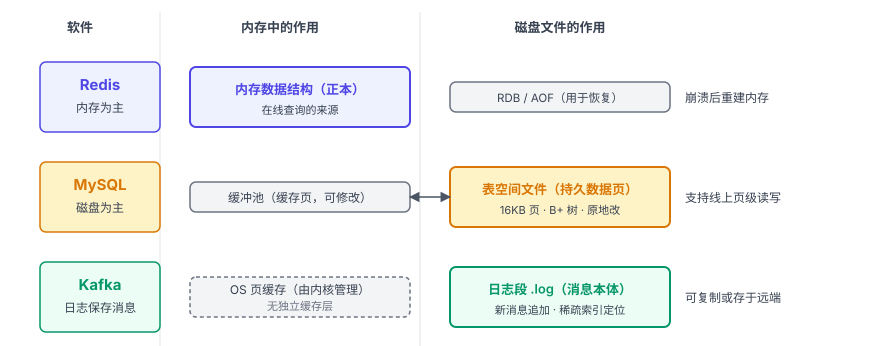
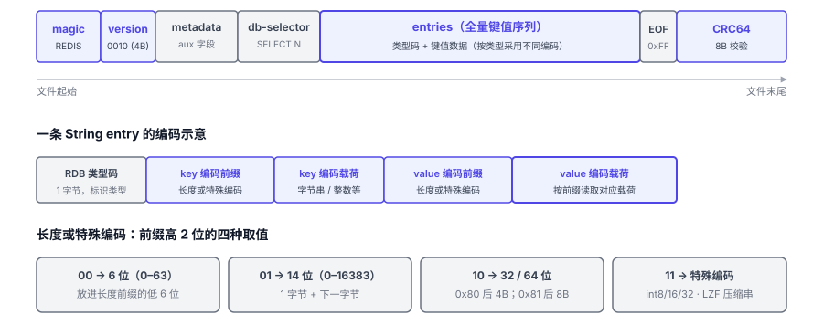
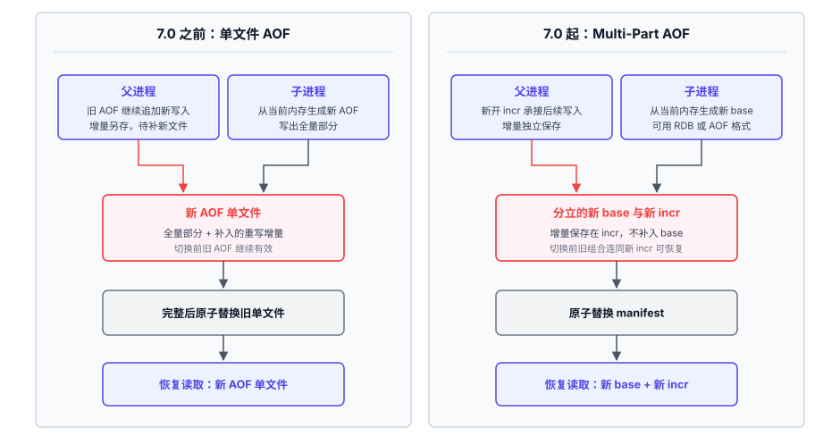
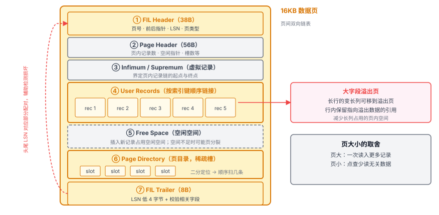
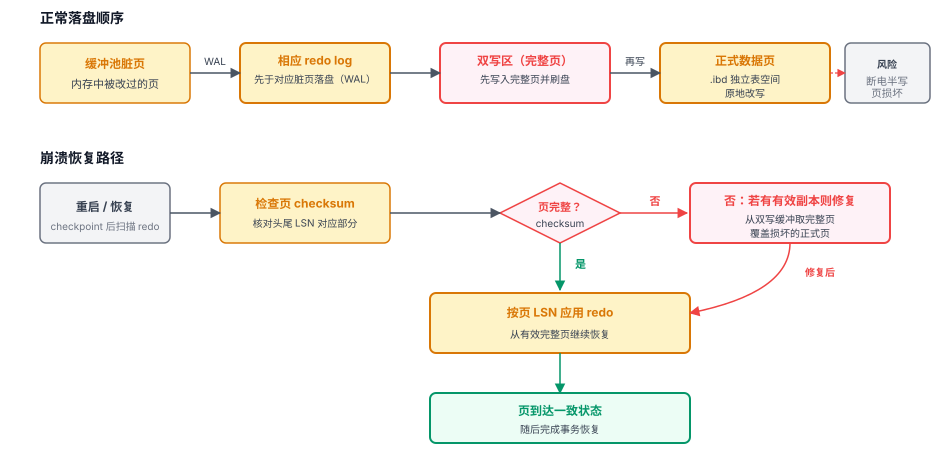
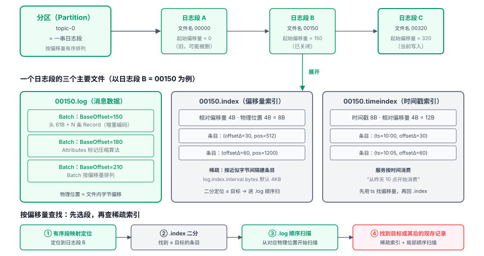
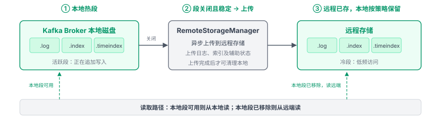
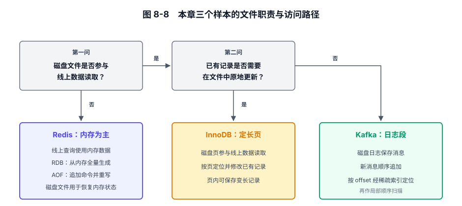

# 第 8 章 磁盘存储格式 — 文件结构的设计哲学

## 本章导读

文件格式增加字段时，需要约定旧程序能否继续读取新文件。版本号用于识别格式；字段的边界与兼容规则，决定旧解析器能否跳过不认识的字段、继续读取后面的内容。

文件格式需要约定字段采用定长还是变长编码、记录怎样定位、怎样检测损坏，以及新旧文件怎样读取。这些选择影响读写、恢复和升级的成本，而选择的依据是文件承担的工作：它是否参与线上查询和更新，又怎样用于恢复。

## 8.1 文件格式要处理哪些约束

磁盘与内存的工程差距，远不止延迟数字。磁盘按块读写，读写位置要对齐到块边界；机械盘的随机访问还有寻道开销。持久化文件可能跨进程、跨机器，几年后仍要由新的程序读取，所以格式需要明确约定字段、字节序和版本。写到一半断电（partial write）留下的不完整数据，也会成为下次启动的恢复问题。对齐、校验、写入顺序和兼容规则因此成为磁盘格式需要共同处理的约束。

Redis 的数据主要放在内存中，RDB 保存快照，AOF 记录写命令，两者用于恢复内存状态；MySQL 用定长页支持线上随机定位和更新；Kafka 将新消息顺序追加到日志段，再用索引定位已有消息。文件承担的读写工作不同，也就形成了不同的组织方式。

图 8-1　三个软件中数据正本、缓存与恢复文件的职责示意。

具体到文件设计，主要涉及四类取舍。

**读写路径**。顺序追加把新数据写在文件尾部；需要快速定位历史记录时，可以用索引缩小查找范围。定长页便于计算页的位置，定位到页后再查找记录，更新时可能发生页内重组。

**空间与解析成本**。紧凑编码可以用编解码的 CPU 开销换取更小的文件与更少的 I/O。定长字段与对齐让定位和解析更直接，空间占用可能更多。

**可靠性与开销**。checksum（校验和）用于发现损坏，双写保留可用于修复不完整页的副本，WAL 记录修改以供恢复，fsync 策略决定何时要求数据落盘。它们增加的计算、写入或等待各不相同；判断开销是否值得，先要明确各自防的是哪类故障。

**定型与演进**。格式发布后，已有数据就成了后续修改的约束。加字段、换编码或修正旧问题时，兼容规则需要约定旧文件怎样继续被读取。版本号和类型码帮助读取端识别格式，保留字段为后续变化留出位置。

四类取舍落到具体文件，还有三个问题：磁盘文件是否参与线上数据读取？已有记录是否需要在文件中原地更新？格式升级或回退时，新旧程序各能读取哪些文件？前两问决定访问路径和更新单位，第三问决定程序要为新旧格式保留哪些读取路径。

## 8.2 Redis 的做法

### 8.2.1 定位先行：磁盘服务于内存

Redis 的线上键查询不依赖持久化文件。RDB 可以紧凑地顺序保存内存状态，不必建立按 key 定位的磁盘索引；AOF 顺序记录写命令，重写时可以根据当前内存状态生成新文件，不必沿用旧文件的内部布局。两者都不需为线上查询维护可原地改写的磁盘页。

### 8.2.2 RDB：紧凑二进制快照

RDB（快照文件）保存 Redis 某一时刻的全量数据，采用紧凑二进制编码。文件以魔数 `REDIS` 和 4 字节 ASCII 格式版本号开头，加载器据此识别文件，并判断是否支持该版本。尾部留有 CRC64 校验字段。启用校验时，Redis 在加载过程中计算 CRC64；若尾部字段非零且计算值与文件值不一致，恢复会中止。

图 8-2　RDB 文件布局

文件中的长度字段按数值大小选择编码：短长度只用一个字节，较大的长度使用更多字节；整数形式的字符串直接存数值，长字符串可用 LZF 压缩。短字段省下的字节累积起来，能减少整个快照的体积。

数据对象通过 RDB 类型码衔接存储态与内存态。以 Hash 为例，Redis 7.0 对 listpack 编码保存其紧凑字节序列，对 hashtable 编码则逐项保存字段和值；加载器按类型码恢复对象，并在相应条件下根据当前阈值转换编码。

类型码也为格式演进提供了区分新旧编码的依据：Redis 7.0 用 listpack 取代旧版 ziplist 时，没有改变 RDB 的整体布局，而是新增类型码，并把 RDB 版本号从 v9 升到 v10，加载器保留新旧编码的读取与转换路径，让新版 Redis 继续读取旧文件。listpack 取代 ziplist 的背景见第 2.2.1 节。

### 8.2.3 AOF：命令记录复用协议编码

AOF（仅追加文件）顺序记录写命令，按客户端请求所用的 RESP 格式写入，参数可以包含二进制数据。恢复时，Redis 沿用命令的解析和执行能力，无需为命令记录另行定义编码。

若以命令重建完整状态，AOF 通常比保存同一状态的 RDB 更大。恢复时，文件中积累的命令都要逐条解析和执行；刷盘频率决定同步等待与故障丢失窗口的取舍，三档参数见第 4 章。

### 8.2.4 AOF 重写：从单文件到 Multi-Part AOF

持续追加而不重写时，即使数据已被覆盖或删除，相应的旧命令仍会保留在 AOF 中，文件随之增长。比如对同一个 key 执行一百万次 INCR，重建当前值不必逐次重放这一百万条命令，可以改写成设置最终计数值的命令。AOF 重写正是根据当前状态重新生成记录：子进程从 fork 时的内存状态生成新文件的全量部分，不必遍历旧 AOF，这部分工作的规模主要随当时的内存数据量变化。

7.0 之前，混合持久化把重写后的 AOF 放在单个文件里：前段是 RDB 全量快照，后段是快照时点之后的 AOF 命令。恢复时先加载快照，再重放增量，缩短了全量部分的加载时间。重写期间父进程继续接收新写入，既向旧 AOF 追加命令，也要把增量补进新 AOF。同一批增量要走两条路径，增加了内存与 I/O 开销。等新文件完整后才能切换；切换前若发生故障，仍可用旧文件恢复。

7.0 起，AOF 拆成基础文件（base）与增量文件（incr），由清单文件（manifest）记录恢复时应读取的文件组合。base 可以采用 RDB 格式，缩短全量部分的加载时间，也可以采用 AOF 命令格式；重写期间的新写入都由 incr 文件保存。

重写开始时，父进程新开 incr 文件承接后续写入，子进程从当前内存生成新 base。新 base 完成后，Redis 原子替换 manifest，恢复所用的文件组合才切换到新 base 与后续 incr；重写失败，恢复仍读原有 base 与原有 incr，加上重写期间新开的 incr。文件分开生成，生效时只需切换一份清单，不必再把重写期间的增量补进新 base。

图 8-3　单文件 AOF 与 Multi-Part AOF 的重写增量衔接

## 8.3 MySQL 的做法

### 8.3.1 定位先行：磁盘为主，内存是缓存

InnoDB 将数据页保存在表空间文件中，缓冲池按需缓存这些页。缓存命中时从内存读取，未命中时再访问磁盘。

线上事务需要随机定位并更新已有记录，因此页要能独立读取、写入和淘汰。UPDATE 可能修改页中的记录，记录变长时也可能触发页内重组或页分裂。InnoDB 用定长页支持定位和原地修改，并用 WAL 与双写机制处理崩溃恢复。

### 8.3.2 四层结构：表空间 → 段 → 区 → 页

InnoDB 的存储从大到小可以分为表空间、段（segment）、区（extent）、页。段是逻辑聚合单位，一棵 B+ 树索引有叶子段与非叶子段，分别管理两类页，便于分配和回收空间。默认 16KB 页下，一个区由 64 个连续页组成，共 1MB。段初期逐页分配，增长后再整区申请，以改善数据的连续性。

页号标识页在表空间中的位置。以单文件、未压缩的 16KB 页表空间为例，页号为 N 的页，其文件内字节偏移为 `N × 16KB`，可以直接计算。定长页把定位所需的信息简化为表空间、页号和页大小。在 B+ 树中，同一层的页又通过页头的前后指针连接，范围扫描可以沿叶子页向后走。页号负责定位，页间链接则支持连续读取相邻键。

页大小影响一次读入的数据量。较大的页可容纳更多记录，有利于顺序访问；较小的页在随机读取少量数据时，可能减少同时读入的无关数据。MySQL 默认使用 16KB 页，也允许在实例初始化时通过 `innodb_page_size` 设置页大小。

### 8.3.3 数据页内布局：一行行记录如何放进 16KB

图 8-4 展示数据页的七段布局。页头记录页号、页类型和日志序列号（LSN）等信息，其中 LSN 标记该页已包含的修改进度；用户记录与空闲区占据页的主体，页目录辅助查找。对于未压缩的数据页，InnoDB 会核对页尾与页头中相应的 LSN 内容是否一致，并结合页 checksum 检测损坏。

图 8-4　InnoDB 16KB 数据页内部七段布局。

页内记录按索引键连接成链表。Page Directory 是页内的稀疏索引，每个槽指向一组记录的末记录。查找时先在槽数组中二分，缩小范围后沿记录链比较，无需从头遍历整页。

InnoDB 默认使用 Dynamic 行格式。行内内容过长时，部分长列移到溢出页，聚簇索引叶子页内保留引用，能容纳更多行内记录。读取被移出的列时，按引用额外访问溢出页。

### 8.3.4 redo log 与双写：原地改页后的恢复

redo log 是循环写入的 WAL。内存中的页可以先被修改；脏页写入数据文件前，相应 redo 必须先落盘。对于页内修改，InnoDB 的 redo log 记录所在页及具体的修改操作。崩溃恢复时，InnoDB 依据日志与页 LSN 应用所需修改，不必重新执行原来的 SQL。日志因此与页结构联系紧密。

原地写页时，断电可能留下半新半旧的内容，导致页结构损坏或 checksum 校验失败。redo log 能重放修改，却不能直接修复任意损坏的页。启用双写时，InnoDB 先把脏页写入双写区并刷盘，再写到正式位置；若正式页发生不完整写入，恢复时可从双写区取得有效的完整副本，再应用后续可用的 redo。多写一份页副本会增加写入量，批量顺序写可以分摊部分 I/O 开销。如果下层存储能保证一页写入的原子性，例如写时复制的文件系统或支持原子写的设备，双写也可以省去。

checkpoint（检查点）标记已写入数据文件的修改进度。恢复过程从 checkpoint 向后扫描 redo log；随着脏页刷盘和 checkpoint 推进，较早的 redo 空间才能复用。

图 8-5　页校验与 LSN 用于判断页状态

## 8.4 Kafka 的做法

### 8.4.1 定位先行：磁盘就是日志本体

Kafka 的分区日志保存消息本体。本地读取优先使用操作系统页缓存，未命中时再访问磁盘。新消息顺序追加到活跃日志段；稀疏索引缩小按偏移量（offset）定位已有消息时的扫描范围；RecordBatch 让一批消息共享元数据，并可一起压缩。

### 8.4.2 日志段（Log Segment）：日志文件与两类索引

Kafka 的分区在磁盘上是一串日志段（segment），每段的主要文件配套管理：`.log` 存消息数据本体，`.index` 存偏移量索引，`.timeindex` 存时间戳索引。删除日志段时删除相应索引，压实时重建相应索引。

文件名使用日志段的起始偏移量，也就是段内偏移量的下界。Kafka 按起始偏移量定位日志段，再在段内查找。

图 8-6　分区 → 日志段 → 三个主要文件的目录与内部结构。

日志段可以按大小或时间切分。段切得太小，文件数量和管理开销会增加；切得太大，单段重写工作量变大，按保留策略整段删除的粒度也更粗。压实（compaction）则按 key 清理旧值，通过重写日志段回收空间，与整段删除互补。

### 8.4.3 RecordBatch V2：把一批消息当成一个存储单元

V0、V1 即使把多条消息包装后压缩，内部消息仍各带一份元数据，一批中的消息越多，重复开销越明显。

V2 把一批消息共享的信息集中到 RecordBatch 固定 61 字节的批头中，保存 BaseOffset 等字段；批内记录用相对差值表示时间戳和偏移量。

批头还保存 ProducerId、ProducerEpoch 和 BaseSequence。这些字段为 Broker 重启后恢复幂等生产所需的状态提供依据。

批同时是压缩的边界：同批消息往往来自同一生产者、字段结构相同，一起压缩的压缩比更高。读取压缩批中的记录，需要解码该批的压缩流，不能把每条记录当成独立压缩单元直接读取；客户端可以边解压边逐条读取。一次读同批多条记录，批头解析与解压的开销由这些记录共同分摊。

### 8.4.4 双索引：偏移量索引 + 时间戳索引

Kafka 用偏移量索引和时间戳索引定位已有消息，两套索引都只记录部分位置。

偏移量索引的条目是 8 字节定长：4 字节相对偏移量（相对日志段起始偏移量）加 4 字节物理位置（在 `.log` 文件中的字节偏移）。`log.index.interval.bytes` 控制索引间隔，默认约每 4KB 建一个条目。查找时，先按起始偏移量定位日志段，再在 `.index` 内二分找到不大于目标的最大偏移量条目，得到物理位置，最后从那里顺序扫描 `.log`，找到目标或其后的首条现存记录。

时间戳索引服务于按时间消费的场景，比如“从昨天上午 10 点开始消费”。条目是 12 字节：8 字节时间戳加 4 字节相对偏移量。查询时先用时间戳索引缩小偏移量范围，再通过偏移量索引定位 `.log` 中的读取位置，继续扫描以找到符合时间条件的记录。

索引间隔较大时，条目较少，索引体积较小，常用部分更有机会留在页缓存中，定位后通常也需要扫描更长的一段日志。

### 8.4.5 格式演进 V0 → V1 → V2

Magic 字段标识消息格式版本，供读取端选择解析路径。

**表 8-1　Kafka 消息格式 V0 / V1 / V2 的字段对比与演进动机**

| 维度 | V0（原始单消息） | V1（加时间戳） | V2（RecordBatch） |
|------|------------------|----------------|-------------------|
| 存储单元 | MessageSet 内的 Message | MessageSet 内的 Message | RecordBatch（可含一条或多条 Record） |
| 时间戳 | 无 | 每条 8 字节 | 每条存与 BaseTimestamp 的差值 |
| 偏移量 | 每条绝对偏移量 | 普通消息为绝对量；压缩内层为相对量 | Batch 存 BaseOffset，每条存差值 |
| CRC | 每条消息一个 checksum | 每条消息一个 checksum | 每个 Batch 一个 checksum |
| 压缩 | 整包 wrapper 压缩，内层各带元数据 | 整包 wrapper 压缩，内层各带元数据 | Batch 级压缩，记录共用批头元数据 |
| 幂等/事务 | 不支持 | 不支持 | 支持（ProducerId/Epoch/BaseSequence） |
| 演进动机 | —— | 加入消息时间语义 | 减少重复元数据，支持幂等与事务状态 |

### 8.4.6 Tiered Storage：从本地日志到分层存储

Kafka 的 Tiered Storage 允许将已关闭的旧日志段保存到远程存储，本地继续保存活跃日志段。

异步上传前，日志段必须已关闭，段内记录也必须都位于最后稳定偏移量之前。该偏移量之前的消息已达到副本复制的提交条件，涉及的事务也已有提交或中止结果。上传成功后，本地的这段日志可按保留策略删除，节省本地空间。

历史数据移到远端后，文件格式可以沿用。消费者请求远端数据时，Broker 从远程存储读取，不必把整段重新建成本地日志段。

副本追赶采用另一条路径。若落后副本所需的数据仍保存在远端，且已不在 Leader 本地，该副本不必将这些旧段重新复制到本地。该副本先恢复与远端段相关的复制辅助状态（如生产者状态快照），再继续拉取 Leader 的本地日志。

图 8-7　Kafka Tiered Storage 日志段生命周期：本地段关闭并满足稳定性条件后异步上传，消费者可经 Broker 读取远端数据。

## 8.5 横向对比

**表 8-2　三个软件的存储格式与读写、恢复方式**

| 维度 | Redis | MySQL | Kafka |
|------|-------|-------|-------|
| 数据的主存储位置 | 内存 | 磁盘 | 本地磁盘；启用分层存储时，旧日志段可存于远端 |
| 磁盘文件组织 | RDB 快照文件 / AOF 文件组 | 表空间文件，由定长页组成 | 分区日志段，由日志文件与索引文件组成 |
| 写方式 | 全量重写（RDB）/ 追加与重写（AOF） | 原地改页 + WAL | 新消息追加，压实时重写日志段 |
| 读方式 | 加载后在内存中查询 | B+ 树定位与页内查找 | 稀疏索引 + 顺序扫描 |
| 索引形态 | 持久化文件无 key 索引，查询使用内存结构 | B+ 树 + 页内 Page Directory | 稀疏偏移量 / 时间戳索引 |
| 崩溃恢复 | 按配置加载 RDB 或 AOF（可含 RDB base） | redo 重放 + 双写修页 | 以日志为正本，校验并截断残缺尾部 |
| 演进机制 | RDB 版本号 + 编码类型 | 行格式与页内格式标记 | Magic 版本号 |
| 损坏检测 | RDB 尾部 CRC64 | 页 checksum 与 LSN 对应部分 | Batch 级 CRC |

Redis 的线上查询使用内存，持久化文件主要在恢复时加载或重放，无须为查询维护磁盘索引。MySQL 的数据页参与线上随机读取和更新，管理数据页、维护 redo log 与执行双写也就成为持续运行的工作。Kafka 将新消息追加到日志段，把旧记录的淘汰或压实留待之后。

## 8.6 架构启示

### 启示一：使用场景决定文件结构

RDB 文件在恢复时顺序读取整份快照，以重建全量内存状态；线上按 key 查询仍使用内存结构。InnoDB 的数据文件参与线上查询和更新，默认用 16KB 页保存多条长短不同的记录。Kafka 让一批消息共享 RecordBatch 的元数据，压缩也以批为单位；读取压缩批内的记录时，需要解码所在批的压缩流。一次读取同批多条记录，可以分摊批头解析和解压的开销。

文件、页和消息批的划分分别服务于这些读写过程，不能直接由一条业务记录的大小决定。

随机读取也不要求所有记录等长。在单文件、未压缩的表空间中，InnoDB 可以按页号和页大小计算文件内偏移，页内记录仍可长短不同。Kafka 的偏移量索引条目采用定长编码，保存消息偏移量与实际日志字节位置；找到条目后就能从对应位置读取日志，消息本身仍可变长。RDB 从头顺序恢复，长度字段按数值大小选择编码：加载器先识别首字节中的编码标记，需要额外字节时再读取相应字节，解析出长度后读取内容。定长页和索引条目省去了查找位置的部分工作，顺序读取则允许逐项解析变长字段。

### 启示二：索引设计服务于查询需求

是否需要磁盘索引、索引保存哪些位置，都与查询怎样使用文件有关。Redis 的线上查询使用内存结构，RDB 因而无须保存用于线上查询的 key 索引。InnoDB 先通过 B+ 树找到数据页，再用页目录把查找范围缩小到一组记录，沿页内记录链逐条比较索引键。Kafka 则先按起始偏移量定位日志段，再用段内索引缩小顺序扫描范围。

索引也不必为每条记录都保存一个条目。Kafka 的段内索引与 InnoDB 的页目录都只记录部分位置，定位后再作局部查找。Kafka 的段内索引默认约每 4KB 日志数据记录一个条目；增大这个间隔会减少索引条目，定位后通常需要扫描更长的一段日志。索引保存在独立文件中，常用部分能否命中操作系统页缓存，也会影响查找开销。InnoDB 的页目录则和记录放在同一数据页中，一起进入缓冲池。页目录中的条目称为槽，槽数会影响目录占用的页内空间，也会影响在这一页内查找记录时的比较次数。

### 启示三：已有数据约束格式升级

Redis 用 listpack 取代 ziplist 时，RDB 新增类型码、把版本号升到 v10，加载器保留旧编码的读取与转换路径。MySQL 8.0 支持 Dynamic、Compact 等行格式，改变新表默认采用的行格式，不会自动转换已有表。Kafka 用消息或批中的 Magic 字段识别格式，读取时选用对应的解析路径。三者都需要处理已经写出的数据。

RDB 可以根据内存中的完整状态重新生成；MySQL 的既有表空间持续参与线上读写；Kafka 追加新消息时，保留期内的历史日志仍供消费者读取。旧数据能在什么环节被替换，三者的条件不同。新的 RDB 可以替换旧快照，已有表需要另行安排转换，历史日志可以继续按受支持的旧格式读取，或在保留期结束后淘汰。只要仍需读取旧文件，对应的解析路径就还要维护。

这些做法解决的是新程序怎样读取已有文件。旧程序读取新文件时，还要约定不认识的字段怎样处理。以新增一个只用于展示的备注字段为例，旧解析器需要能识别这个未知字段的边界，并按约定跳过它，才能继续读取后面的内容；新字段若改变了记录的解释方式，旧程序拒绝读取反而更安全。

格式升级时，可以让新程序同时读取新旧两种格式，也可以在交接窗口里把旧文件一次性转换掉。前一种做法允许旧文件继续使用，兼容代码也需要继续维护；后一种做法把文件转换集中到交接窗口，转换时机要与新旧程序的切换配合。

图 8-8　本章三个样本的文件职责与访问路径。

## 8.7 小结

存储格式限定了记录怎样定位和更新，也影响重启时的数据重建与运行中的旧数据清理。第 9 章接着讨论数据同步：当增量无法继续衔接时，系统从哪里重新取得完整状态。
