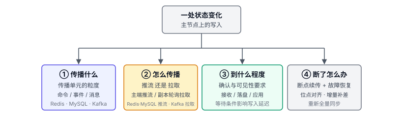
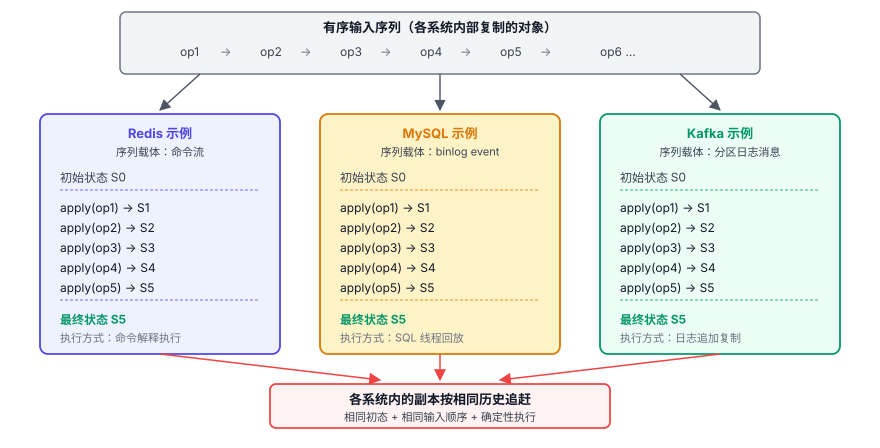
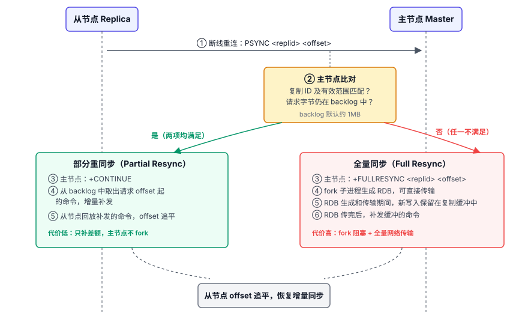
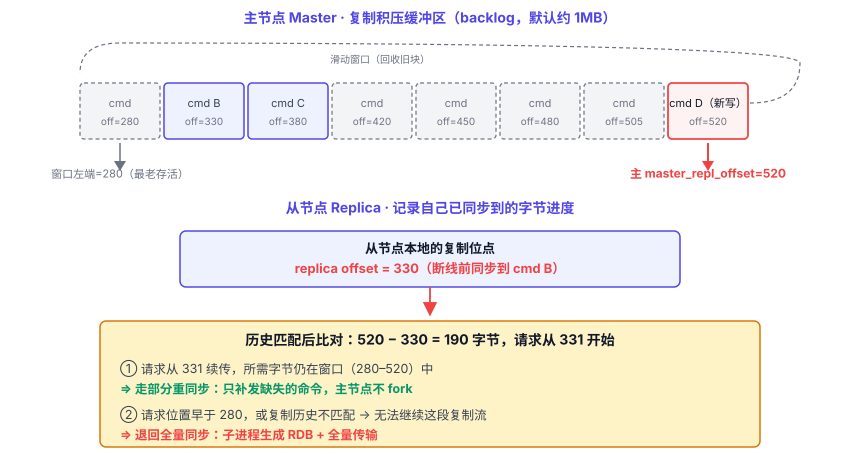
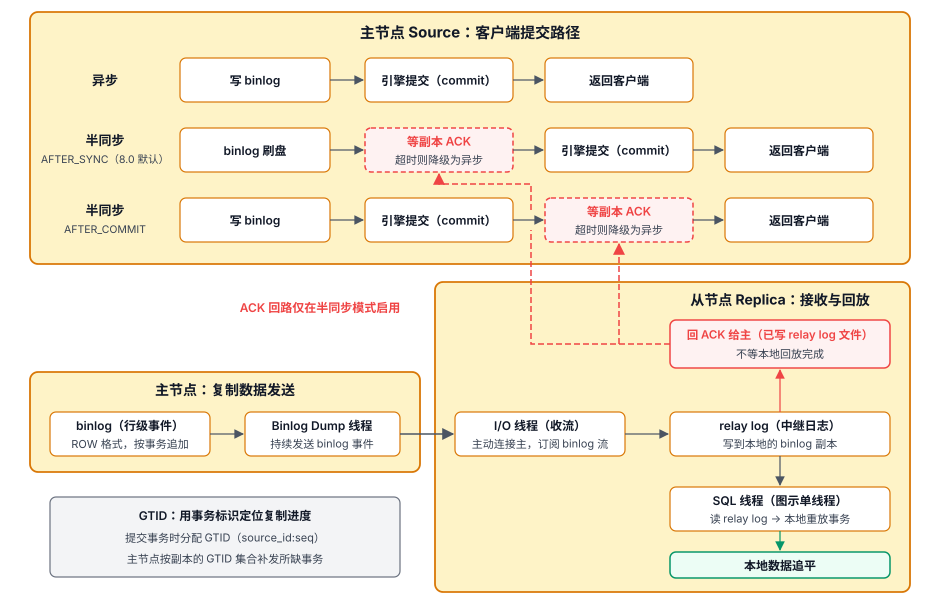
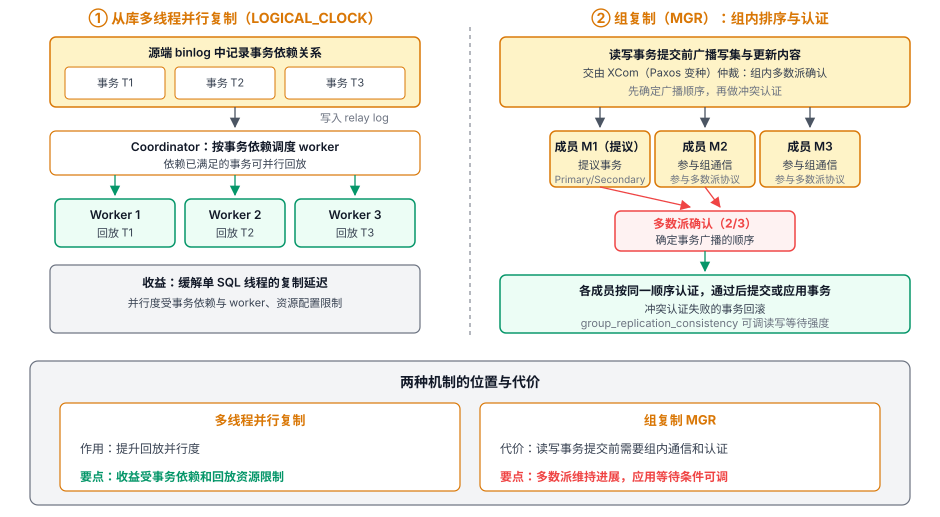
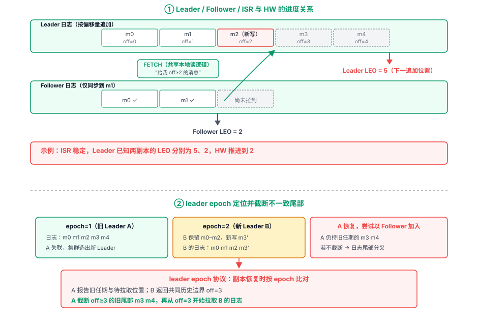

# 第 9 章 数据同步机制 — 集群一致性的实现

## 本章导读

系统扩展到多副本后，主节点的一次写入要传到其他节点。新写入的记录，从节点什么时候能看到？网络断开后，副本怎么补上漏掉的部分？这些问题处理不好，轻则用户看到旧数据，重则故障切换后缺少已确认的写入。

Redis 用命令流、MySQL 用 binlog event、Kafka 用分区日志消息传播变化。三者都要记录顺序和进度，并在断线后判断能否续传。第 7 章讨论了集群拓扑与选主，本章看副本怎样追赶主节点，以及写入确认和读取可见性的边界。

用户修改资料时，如果数据库已经写入新值，缓存却未失效，刷新页面就可能仍显示旧资料。多份数据的写路径需要明确以哪份数据为准，以及其他数据怎样与它对齐。

## 9.1 问题的本质

为了提高可用性或分担读请求压力，系统可以增加副本。主节点上的写入需要传播到副本，这个过程需要时间。采用异步复制时，主节点不等待副本确认就向客户端返回成功；如果主节点随后发生故障，接替它的副本可能还没有收到这次写入。等待副本确认再返回，则会延长客户端的等待时间。

在上述缓存场景中，数据库是正本，缓存是可重建的派生数据。本章讨论的是同一份数据的副本如何追赶主节点，以及断线后如何续传。

### 9.1.1 数据同步的四个子问题

**第一，传播什么。** 一次状态变化，到底把什么东西传给副本？是命令本身（“执行 `SET k v`”）、是事件（“行 k 的值变成了 v”）还是消息（“编号 7 的记录内容是 v”）？传播单元的粒度影响副本如何回放，以及进度和补发范围如何表示。

**第二，怎么传播。** 是一次请求后主端持续推流（Redis、MySQL），还是由副本发起一轮轮拉取（Kafka）？持续推流需要管理发送缓冲与慢副本；主动拉取让副本控制请求节奏，便于按当前需求取一批数据。

**第三，传播到什么程度才算数。** 主节点完成本地操作就向客户端返回，还是要等待副本收到、刷盘或应用？这些确认代表不同的保证。

**第四，传播断了或乱了怎么办。** 网络中断、副本重启或主节点更换后，能不能不从头再来，从哪里接着传？系统需要记录同步位点，并能在重启时用它对齐。

图 9-1　数据同步的四个子问题：传播什么、怎么传播、到什么程度、断了怎么办。

副本状态怎样对齐，可以借助**状态机复制**来理解：从相同的初始状态出发，按相同顺序执行相同输入，并且执行是确定性的，副本就会得到相同状态。Kleppmann《Designing Data-Intensive Applications》在“一致性与共识”一章对此已有展开。三个软件都用日志或命令序列记录变化：Redis 的副本执行命令流，MySQL 的副本回放 binlog event，Kafka 的副本按偏移量复制分区日志。

图 9-2　状态机复制模型：以三个软件为例，对照输入载体与副本处理方式；各系统内的副本按相同历史追赶。

同一个“随机选一个成员”，两台机器可能选出不同结果。复制时要传播已经选中的成员，而不是让副本再随机一次。Redis 的命令改写，解决的就是这类问题。

读取副本时，还要考虑复制延迟。主节点写入新订单后，从节点还没同步到，查询若恰好落在从节点上，就可能查不到这笔订单。“数据已写入”和“用户能看到”之间有一个时间窗口。对写后立即读取的请求，可以优先路由到主节点，减少副本延迟的影响。

## 9.2 Redis 的做法

Redis 用单向命令流异步复制数据，尽量减少主节点等待副本确认的时间。

### 9.2.1 传播单元：命令本身

Redis 把传播命令作为复制单元。主节点执行写命令后，把需要传播的命令按 RESP 编码发送给副本；这份命令可能已根据实际执行结果改写。副本在相同的起始数据上按顺序执行传播命令，追赶主节点的状态。

这个做法呼应了第 8 章“AOF 持久化文件复用协议格式”的设计：经主节点改写的传播命令按 RESP 编码，进入 AOF 的命令部分和复制流。两条路径可以复用命令传播与解析处理逻辑。

副本重新执行非确定性命令时，可能得到不同结果，例如随机删除集合成员，或按当前时间计算过期时刻。Redis 按主节点的执行结果传播确定的操作：用指定成员的 `SREM` 命令传播删除结果，把有效过期时间改成绝对时间戳；脚本也传播实际产生的写入效果，不让副本重新计算。

### 9.2.2 单向异步：减少写入的确认等待

Redis 复制是**单向异步**的。主节点通常在本地执行写命令后向客户端返回结果，**不等待副本确认**；副本通过长连接接收命令流并追赶。每个副本只有一个上游主节点，也可以继续向下游副本传播，形成树状复制拓扑。

命令传播会消耗主节点的 CPU、网络与缓冲空间，慢副本也可能因输出缓冲超限而被断开。故障转移时，老主已向客户端确认的写入若尚未复制到新主，就可能丢失。

### 9.2.3 全量同步：fork 子进程生成 RDB，传完补增量

副本首次连接时会请求全量同步；增量同步无法进行时，也要转入全量同步。进入全量同步后的流程是：

1. 主节点 fork 子进程生成 RDB，并将快照传给副本。
2. 在 RDB 生成和传输期间，主节点继续处理写入，并在复制缓冲中保留这段时间产生的命令流。
3. 副本加载 RDB 后，得到主节点 fork 时的数据快照。
4. 主节点继续发送快照之后保留的复制流，副本执行这些增量，逐步追赶。

全量同步还会带来几项代价：fork 要复制页表，可能造成短暂停顿；子进程运行期间，父进程修改内存页会触发写时复制（COW），额外内存占用随被修改的页数增加。RDB 的网络传输还会消耗主节点出口带宽。部分重同步可以减少反复全量同步带来的这些开销。断线重连时的部分重同步与全量回退见图 9-3。

图 9-3　PSYNC2 同时核对复制历史与续传位置：复制 ID 有效且所需字节仍在 backlog 中，才能部分重同步，否则退回全量。

### 9.2.4 增量同步：PSYNC2 与复制积压缓冲区

PSYNC2 解决的是“断线重连能不能不从头同步”。它需要复制 ID、偏移量和保留的复制流一起配合：ID 核对历史，偏移量标明进度，backlog 提供可补发的数据。

**复制偏移量（replication offset）**：主节点用 `master_repl_offset` 记录复制流推进到的字节位置；副本用自己的已处理偏移量记录执行进度，`INFO replication` 中对应 `slave_repl_offset`。位点按复制流的字节计数，需要与复制 ID 一起解释。

**复制积压缓冲区（backlog）**：主节点为断线续传保留最近一段复制流，规模由 `repl-backlog-size` 控制，默认约 1MB。

副本断线重连时，通过 `PSYNC <replid> <offset>` 发送已知的复制 ID 和希望接收的下一个字节位置。主节点先验证复制历史是否匹配，再检查所需字节是否仍在 backlog 中。

- 条件满足 → **部分重同步（partial resync）**：从请求的位置继续发送保留的复制流，追赶时间取决于落后量和净处理速率。
- 历史不匹配或所需字节已不可得 → 退回全量同步。

图 9-4　backlog 滑动窗口：复制历史匹配且请求范围落在保留窗口内时，可增量补差；否则需要全量同步。

确定 backlog 大小时，需要在断线容忍时间与内存占用之间取舍：写入速率相同时，窗口越大，能覆盖越长的网络抖动或副本停顿，也要占用更多内存。可以根据写入字节速率和常见断线时长估算所需规模。

副本重连后，既要补断线期间的积压，也要继续处理主节点的新写入。设落后量为 B 字节，副本的有效处理速率为 C，主节点同期的写入速率为 W。只有 C 大于 W，副本才有净追赶能力；速率恒定时，追赶时间约为 `B/(C-W)`。

故障转移后，新主会生成新的 replid，把老 replid 保存为 `replid2`，并记录旧复制历史的有效偏移上限。副本拿老 ID 续传时，既要满足这个上限，也要满足 backlog 仍保留所需字节，才能走部分重同步。这放宽了更换主节点后续传的限制。

### 9.2.5 关键取舍：用副本状态限制是否接受写入

Redis 提供了一组可写门槛：`min-replicas-to-write N` + `min-replicas-max-lag T`。启用后，主节点接受写入前，要求至少有 N 个在线副本在最近 T 秒内发来复制 ACK。这里的 lag 指距上次 ACK 的时间。

达不到这道副本状态门槛，主节点就拒绝写入；通过门槛后，写入仍以异步方式传播，故障转移时可能丢失。

还可以在本连接上单独调用 `WAIT N T`，对先前写入追加确认等待。它等待至少 N 个副本确认本连接此前写入所对应的复制偏移量；T 毫秒超时后返回实际确认数。`min-replicas-to-write` 是写入前的副本状态门槛，`WAIT` 是对已发出写入追加的确认等待。

### 9.2.6 级联复制与延迟累积

副本也可以作为下一级副本的主，形成树状（tree）复制拓扑。常见动机是分担主节点的出口带宽：主只推给少数几个一级副本，一级副本再推给二级副本。

复制流经过一级副本，再到二级副本，后续各级也依次从上游接收，传播延迟逐级累积。链路较深时，主节点的一部分新写入可能还没有同步到末端副本，用户从它读取时可能看到旧数据。

### 9.2.7 故障转移的数据语义

Sentinel 或 Cluster 选出新主时，老主在故障前已向客户端确认的某些写入，可能还没有传到新主。老主恢复后以副本身份重新加入，新主会用自己的数据覆盖老主上的数据。

## 9.3 MySQL 的做法

MySQL 提供异步复制、半同步复制和组复制（MGR），让使用者按业务选择副本确认与事务协调方式。MySQL 的同步以 binlog event 为传播单元。

### 9.3.1 传播单元：binlog event

MySQL 通过 binlog event 传播变更。以 ROW 格式的数据修改为例，它记录的是已经确定的行变更，如“行 k 的值从 v1 变成 v2”。

采用 ROW 格式，可以减少重新执行语句带来的差异。例如，直接重放包含 `UUID()` 的语句，可能生成不同的值；ROW 格式把已经确定的行变更传给副本，不再重新计算这个值。这和 Redis 处理非确定性命令是同一类思路：在源头确定要传播的变更。

ROW 格式传播的是具体的行变更：一条 `UPDATE ... WHERE id<100` 如果实际改动了一百行，就需要记录这一百行的变更。日志量可能更大；对复制正确性来说，这个代价值得付。

### 9.3.2 传统复制：两段式的收流 + 回放

MySQL 的传统异步复制分为**接收和回放两段**。先以单线程回放为例：

- **I/O 线程（从节点上）**：主动连接主节点，订阅主节点的 binlog 流，把收到的事件写入本地的中继日志。这一段是“收流”：副本发起后，主端 dump 线程把事件流持续推过来。
- **SQL 线程（从节点上）**：读 relay log，按顺序回放事件到本地存储引擎。这一段是“本地回放”。

接收和回放分开后，I/O 线程可以先把事件写入 relay log，SQL 线程按本地引擎的速度执行。relay log 用缓冲空间吸收两者的速度差。

图 9-5　异步 / 半同步 / GTID：异步复制完成本地提交后返回；半同步默认采用 AFTER_SYNC，在 binlog 刷盘后、引擎提交前等待副本 ACK，AFTER_COMMIT 则在引擎提交后等待。副本确认不等待事务应用完成，GTID 以事务标识辅助定位复制进度。

### 9.3.3 异步复制：本地提交不等待副本

默认配置下，MySQL 复制是异步的：主节点完成本地事务提交后就给客户端返回 OK，不等待副本确认。如果主节点此时发生故障，接替它的副本可能还没有收到这些已提交的事务。

### 9.3.4 半同步复制：可降级的副本确认

半同步在提交路径上增加了副本确认：正常半同步状态下，主节点要等到规定数量的副本确认接收并记录事务日志，才向客户端返回成功；它不等待副本应用完事务。它有两档等待时点。`AFTER_SYNC`（8.0 默认）是主节点先将 binlog 刷盘，等副本 ACK 后再提交到存储引擎。`AFTER_COMMIT` 则先在引擎层提交，再等 ACK。这一档有个危险窗口：事务先在引擎层提交，其他会话已经能读到它；若主节点在副本 ACK 返回前崩溃，晋升的新主可能没有这笔事务；之前读到它的会话，等于看见数据消失。

半同步还可降级：等待 ACK 超过 `rpl_semi_sync_source_timeout`（默认 10 秒）后，会暂时转为异步，不再等待副本确认。

故障转移时，必须选择持有已确认事务的副本，并保留、应用其 relay log。

MySQL 暴露当前半同步状态与降级次数，用于识别写入是否仍等待副本确认。

### 9.3.5 GTID：用事务标识辅助切换复制源

传统复制用“文件名 + 字节偏移”作为位点（比如 `mysql-bin.000123:4567`）。这种位点只对相应复制源的日志有效。换主时，新主的文件名和位置可能不同，人工对齐既繁琐又容易出错。

GTID（Global Transaction Identifier，全局事务标识）用 `source_id:transaction_id` 标识一笔事务：`source_id` 是发起事务的源节点的 UUID，`transaction_id` 是该节点上单调递增的事务序号。

自动定位以新主保有所需 binlog 为前提。启用后，副本把已经接收或提交的 GTID 集合告诉新主，新主从自己的 binlog 中发送副本缺少的事务，不用人工对文件、查偏移。故障切换、级联复制、多源复制（一个副本同时从多个源同步）都因此更容易管理。

### 9.3.6 多线程并行复制：缓解单线程回放瓶颈

当主节点持续写入，而从节点的单线程回放速度跟不上时，复制延迟会不断增加。多线程并行复制把没有依赖关系的事务交给多个 worker 回放。

`LOGICAL_CLOCK` 使用主节点记录在 binlog 中的事务依赖信息，判断哪些事务可以并行回放。源端的提交关系或写集决定了可识别的并行范围；有依赖的事务仍须按顺序应用。

并行回放的能力受源端并发、事务依赖、worker 数量和回放资源限制。并行复制与 MGR 共识的关系见图 9-6。

图 9-6　并行回放与 MGR：从节点按依赖标记调度回放，MGR 通过组通信建立事务顺序，再进行认证和提交。

### 9.3.7 组复制（MGR）：在复制中加入事务协调

MGR（MySQL Group Replication）在复制链路中加入组内事务协调。读写事务准备提交时，节点广播行变更及对应写集。基于 Paxos 的 XCom 提供组通信，为消息确定统一的顺序；各成员都按这个顺序进行冲突认证，通过认证的事务才能提交。

组通信需要多数派才能继续作出决定，因此少数成员故障时，只要剩余成员仍能形成多数派，组就能继续运行。事务通过认证后，发起节点提交本地事务，其他成员应用这笔远端事务。

组通信与认证增加了提交等待。跨成员读取是否等待追平，由 `group_replication_consistency` 控制：MySQL 8.0 默认 `EVENTUAL` 不额外等待；其他设置可以在主切换后、事务执行前或返回提交结果前等待相应成员应用。

### 9.3.8 分布式恢复：新成员怎么追上

新成员加入 MGR 时，要从现有成员（donor）补齐数据。所需 binlog 仍可用时，可以增量恢复；无法用 binlog 补齐时，可以借助 clone 插件先克隆物理数据建立基线，再用 binlog 追平期间的新事务。这是“先全量再增量”的做法，思路和 Redis 的“RDB 快照 + 期间增量补发”相近。

### 9.3.9 取舍总结

MySQL 在数据同步上提供了不同选择：异步复制不等待副本，半同步增加可超时降级的接收确认，组复制增加组内事务协调和可配置的一致性等待。业务方需要分别判断确认范围、故障转移条件和读取要求。

## 9.4 Kafka 的做法

### 9.4.1 传播单元：按分区有序的消息

Kafka 把消息直接保存在分区日志里，副本复制的也是这条分区日志。第 5 章讲的存储层 Log 抽象在这里提供按分区有序的复制输入：Leader 为新消息分配分区内偏移量（offset），副本按此顺序复制。

### 9.4.2 拉模式：复用本地日志读取逻辑

Kafka 复制用的是**拉模式**：Follower 主动向 Leader 发 `FETCH` 请求拉取日志。Redis、MySQL 则由副本先发起请求，再由主节点持续推流。

**Follower 与消费者复用底层日志读取**。Follower 要拉取尚未完成复制提交的尾部，普通消费者只能读取已完成复制提交的部分；`read_committed` 读取还要等待事务结果确定。

Kafka 的多个副本向 Leader 发起 FETCH，各自控制追赶节奏；批量读取和页缓存降低 Leader 处理这些请求的开销。

### 9.4.3 LEO、HW 与 ISR：同步进度的度量

Kafka 用 LEO（Log End Offset，日志末端偏移量）和 HW（High Watermark，高水位）描述副本的同步进度，用 ISR（同步副本集合）框定“谁算跟上”。ISR 的定义与动态进出机制已在第 7.4.2 节展开。

LEO 表示日志下一条消息的追加位置，HW 表示已经完成复制提交的边界。例如 Leader 的 LEO 是 105、HW 是 103，那么 offset 103 和 104 已写入日志，还没有完成复制提交。Leader 根据 FETCH 中获知的副本进度和 ISR 状态推进 HW。ISR 稳定且满足最小副本数要求时，较慢副本的已知进度会限制 HW 的推进。副本长时间未追上 Leader，超过 `replica.lag.time.max.ms` 后会被移出 ISR，Leader 随后按调整后的集合推进 HW。Leader、Follower、ISR 与 HW 的时间关系见图 9-7。

图 9-7　HW 与 leader epoch：Leader 根据副本反馈的进度推进 HW；leader epoch 标识任期边界，帮助恢复中的副本定位并截断不一致尾部。

### 9.4.4 leader epoch：定位旧 Leader 日志中的分叉

旧 Leader 恢复后，可能带回与新 Leader 不一致的日志尾部。场景是这样的：Leader A 在任期 1 写了几条消息后失联，集群选出 Leader B 进入任期 2，B 又写了几条；此时 A 恢复，仍保存着任期 1 的本地日志，需要先与当前 Leader 对齐。

Kafka 用 **leader epoch**（单调递增的任期号）标识日志的任期边界，并记录各任期的起始偏移量。旧副本重新追随时，当前 Leader 根据任期和偏移量判断两边的历史是否分叉；如果分叉，副本先定位共同日志的边界，截断不一致尾部，再继续拉取。

leader epoch 补充了 offset 所没有的历史信息：相同偏移量在不同任期可能对应不同的日志内容。Redis 的 replid 也用于区分复制历史；MySQL 的 GTID 则标识事务来源和事务身份。它们都让位点带上了可核对的来源信息。

### 9.4.5 acks 参数：生产者的写入确认要求

Kafka 通过生产者侧的 `acks` 参数（0 / 1 / all 三档）设置写入确认要求。`acks=all` 要求 ISR 数量达到 `min.insync.replicas`，且当前 ISR 中的全部副本完成日志复制；逐条 fsync 不是返回确认的前提。`min.insync.replicas=1` 时，ISR 收缩到只剩 Leader 后可以继续写入，`acks=all` 实际只等 Leader 本地确认，语义退化接近 `acks=1`。三档的完整定义已在第 7.4.3 节展开。

`acks=all` + `min.insync.replicas` 与 MySQL 半同步在**降级语义**上存在关键差别：MySQL 半同步确认超时后可降级为异步；Kafka 不会因为 ISR 不足而自动按更低的确认要求返回成功。涉及钱和库存的写路径，宜在确认条件不足时明确失败，避免自动降低要求后返回成功。能容忍缺失的日志、监控数据，则可以考虑降级。

一个常见的配置是副本数 3、`min.insync.replicas=2`、`acks=all`：它可在一个副本故障后继续写入。

### 9.4.6 unclean leader 选举：数据保留与恢复可用性的取舍

`unclean.leader.election.enable` 控制是否允许**非 ISR 副本**当选 Leader。没有可用的 ISR 成员时，这个开关决定是否接受从落后日志恢复服务的风险：

- **允许（true）**：所有 ISR 副本均不可用时，从落后副本中选一个当 Leader，系统恢复可用；新 Leader 缺少的消息可能丢失，其中也可能包括原先已提交、位于 HW 以下的消息——可用性优先。
- **禁止（false，3.x 默认）**：所有 ISR 副本均不可用时不选主，等待 ISR 成员恢复，分区在此期间不可用。

### 9.4.7 KRaft：元数据也采用复制日志

Kafka 用 KRaft（Kafka Raft）替代 ZooKeeper 管理集群元数据。**元数据变更记录在一条 Raft 复制日志中**，这条日志由 Controller quorum 维护。KRaft 使用多数派共识，数据分区按 ISR 机制推进复制提交。两者都使用日志、Leader、副本与任期信息，复用了日志化状态管理的思路。

### 9.4.8 幂等与事务：处理重试与跨分区提交

启用生产者幂等（`enable.idempotence=true`）后，生产者按分区维护消息序列号，并在批次中携带 ProducerId、ProducerEpoch 和起始序列号 BaseSequence。Broker 按分区保存各生产者已追加批次的序列号信息，核对 ProducerId、ProducerEpoch 和批次的序列号范围。识别为重复的批次不再追加到日志。

事务把多项 Kafka 写入纳入同一提交单元，由 transaction coordinator 协调，可以包含跨分区写入及消费 offset 的更新。每个事务的开始、提交或中止由应用发起。提交或中止结果通过控制记录传播。

`read_committed` 的读取范围受 LSO（Last Stable Offset，最后稳定偏移量）限制：在已完成复制的范围内，较早的事务尚未结束时，后面的记录也可能暂时不能返回。在可读范围内，它返回已提交事务的记录和非事务消息，跳过中止事务。默认的 `read_uncommitted` 不作这种事务隔离，可能返回未提交或已中止事务的记录。

外部系统的处理结果不在 Kafka 事务的提交单元内。消费端需要区分三件事：客户端当前读到的位置、已提交给 Kafka 的消费组进度，以及业务系统里的处理结果。因此，提交消费进度时，不能越过同一分区中尚未处理完成的已交付记录。例如，offset 为 100、101、102 的三条记录中，100 和 102 已完成，101 还没完成，此时消费进度最多可以提交到 101；提交 101 表示下次从 101 继续。三条都完成后才能提交 103。按分区顺序处理完记录再提交，能让已完成记录自然形成连续前缀，代价是降低分区内的消费并行度。处理成功后、提交进度前发生故障，恢复时仍可能重复处理记录。

## 9.5 横向对比

**表 9-1　三个软件数据同步机制横向对比**

| 维度 | Redis | MySQL | Kafka |
|------|-------|-------|-------|
| 传播单元 | 命令流（必要时改写为确定操作） | binlog event（默认 ROW 行级） | 消息（按分区偏移量有序） |
| 传播方式 | 副本发起后持续推流（复制缓冲） | 副本发起后持续推流（relay log 缓冲，接收与回放分离） | FETCH 请求-响应（副本发起拉取） |
| 确认与协调 | 默认异步；WAIT 可等待此前写入的副本确认 | 异步、半同步确认或 MGR 组内协调 | ISR + acks + min ISR |
| 位点语义 | replid + replication offset（历史与字节进度） | GTID 集合（标记事务来源及已接收或已提交的事务） | 分区 offset + leader epoch |
| 故障恢复条件 | 历史匹配且所需日志仍在 backlog，才能部分重同步 | GTID 自动定位需有可补发日志；组复制可克隆 | 以任期检查分叉，再从有效保留范围追赶 |
| 建立副本基线的代价 | fork 与 RDB 传输；子进程运行期间，父进程修改内存页可能带来 COW 开销 | 备份恢复或克隆数据，再补所需 binlog | 获取分区保留日志及必要辅助状态 |

## 9.6 架构启示

### 启示一：续传取决于位点、历史和保留窗口

位点标明进度。用它续传时，还需明确它属于哪段复制历史、记录的是接收进度还是处理进度，以及重启后从哪里取得这个位点。副本续传需要核对历史，并确认源端保留着缺失的变化。历史分叉须先确定共同部分；所需变化无法从可用来源补齐时，则重新建立基线，再接上后续增量。

保留窗口要覆盖常见断线时间；恢复连接后，只有副本的处理速率高于新增写入速率，才能追平。这些条件也决定故障恢复能否复用日常的补差路径。

### 启示二：业务要求决定复制确认与等待策略

复制系统的保证与等待需要一起确定：业务需要保留什么数据、允许看到多旧的结果，以及为这些保证能承受多少等待。客户端收到成功、从副本读到新值，以及故障切换后这笔写入仍被保留，三者所需的条件各不相同。确认条件无法满足时，还要明确是失败、继续等待，还是允许降级；MySQL 半同步超时后可降级，Kafka 的 `acks=all` 在 ISR 数量低于 `min.insync.replicas` 时，不会自动降低确认要求后返回成功。

### 启示三：级联复制会累积传播延迟

在 Redis 链式副本和 MySQL 级联复制中，中间副本可以继续向下游发送新写入，主节点只向一级副本发送。新写入逐层到达末端，链路越深，末端副本越晚看到它。如果业务需要尽快从末端副本读到新写入，较浅的复制拓扑更合适，主节点相应需要更多出口带宽。

## 9.7 小结

Redis、MySQL、Kafka 的副本续传，都要靠可核对的进度与历史确定续传位置；所需变化无法从可用来源补齐时，就要重新建立基线。写入确认约定成功前等待哪一步，读取可见性受副本应用进度与读取规则影响，故障转移还要判断接管副本保留了哪些写入。
