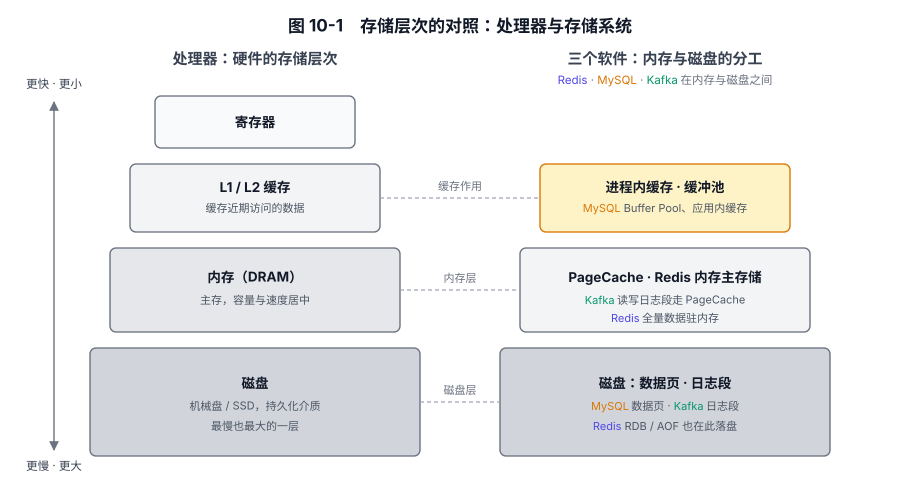

# 第 10 章 总结：架构设计的共性规律与取舍

## 本章导读

前九章以 Redis、MySQL、Kafka 为样本，讨论了同一组设计问题；内存结构、事务恢复和批量日志等不同选择，都有各自成立的条件。本章从这些选择归纳能用于自己系统的取舍规律。

---

## 10.1 前九章的关键选择

第 1 章说明为什么选 Redis、MySQL、Kafka 作为观察样本；表 10-1 对照第 2 至第 9 章三个软件的关键决策。

**表 10-1　八个主题的关键决策**

| 章 | 核心问题 | Redis 的关键决策 | MySQL 的关键决策 | Kafka 的关键决策 | 一句话共性启示 |
|---|---|---|---|---|---|
| 第 2 章 数据结构与协议 | 如何按主要访问方式组织数据与通信 | RESP 分帧 + 按类型和数据规模选择结构与编码 | B+ 树 + Dynamic 行格式 + 文本/二进制协议与预编译 | RecordBatch V2 批量编码 + 变长整数/增量时间戳 | 数据结构与编码服务主要访问方式，协议减少每次访问重复的工作 |
| 第 3 章 生命周期 | 启动和关闭各要完成哪些工作 | 启动时加载 RDB 或重放 AOF；关闭时完成已启用的 AOF 刷盘，并选择是否生成 RDB | 崩溃恢复时重放 redo log、用 undo log 回滚未提交事务；关闭档位决定刷盘与清理工作如何安排 | 检查并恢复分区日志、取得所需元数据；受控关闭先交接分区 Leader | 启动重建运行状态；关闭完成必要收尾，职责可在退出前交接或退出后接管 |
| 第 4 章 内存与磁盘 | 内存和磁盘怎么分工 | 内存保存运行数据，磁盘文件用于恢复 | 磁盘保存数据页和日志，内存作缓冲 | 分区日志保存消息，PageCache 加速访问 | 访问模式影响内存与磁盘的分工，以及故障后的恢复方式 |
| 第 5 章 分层架构 | 怎样划分职责与变化边界 | redisObject 的 type/encoding 分离 | THD + Handler 虚函数（可插拔引擎） | RequestChannel 队列 + 对象调用，跨 Broker 使用网络协议 | 分层隔离职责与变化，接口契约影响替换范围与演进成本 |
| 第 6 章 安全 | 怎样确认身份、限制访问、保护数据和追查操作 | requirepass 与 ACL | 用户、角色与对象权限，授权表持久保存 | SASL + ACL + 按连接配置 TLS | 安全设计需要区分身份、权限范围及每段连接的保护 |
| 第 7 章 集群 | 数据怎么分片，故障怎么接管 | 主从复制、Sentinel 自动接管与 Cluster 槽分片 + Gossip | 异步或半同步复制；MGR 通过基于 Paxos 的组通信进行多数派协调 | 分区 + ISR + KRaft（去 ZooKeeper） | 复制确认与故障处理提供不同保证，按业务需求权衡代价 |
| 第 8 章 存储格式 | 字节怎么排列才好访问 | RDB/AOF 为“全量加载 + 增量重放”优化 | 默认 16KB 页 + B+ 树为“点查 + 范围扫描”优化 | 日志段 + 稀疏索引为“顺序追加 + 偏移量定位”优化 | 格式需要协调访问、恢复与兼容，发布后就是一笔长期债务 |
| 第 9 章 数据同步 | 怎么让副本对齐数据 | PSYNC2（部分重同步 + 全量回退） | binlog + GTID 集合（识别已接收和执行事务） | ISR + leader epoch 日志对齐 + acks/幂等/事务 | 在匹配的复制历史内确认进度，并依靠保留的日志或快照补齐数据 |

这些选择串起来只有一条主线：**约束决定哪些选项可行，目标决定在可行选项里怎么选**。三个软件面对的是同一组物理约束：内存有限、磁盘慢、网络会分区、机器会宕。

---

## 10.2 从三个软件归纳的共性规律

### 10.2.1 规律一：先确定数据的正本

> **先为每类数据确定权威来源（source of truth），再区分副本和派生结果。权威来源可以由多个物理副本共同保存；保留它和必要的恢复材料，其他数据才有重建依据。**

在 Redis 中，内存键空间是运行时处理命令的依据，RDB 保存快照，AOF 保存恢复数据所需的日志。崩溃后能恢复到哪里，取决于已保存的持久化内容。

在 MySQL 中，磁盘上的数据页和已持久化的 redo log 共同提供崩溃恢复依据，缓冲池里尚未刷回的修改可以通过 redo 恢复。

在 Kafka 中，消息保存在分区日志中，PageCache 缓存日志内容，多个副本共同提供容错能力。消费组的进度是另一份需要单独保存的状态，提交的偏移量标记下次从哪里继续消费。

如果把缓存和数据库都当正本，两者不一致时就难以确定应恢复哪份数据。

系统以哪份数据为准，与数据平时放在哪里，是两个问题。Redis 以内存保存运行数据；MySQL 的缓冲池和 Kafka 使用的 PageCache 则缓存磁盘内容。图 10-1 将这些安排与处理器、内存、磁盘的存储层次对照。硬件的访问延迟与容量约束，会影响这三个软件的数据放置方式。

图 10-1　存储层次的对照：左侧为处理器与存储介质，右侧为三个软件使用内存与磁盘的方式。

### 10.2.2 规律二：分层隔离实现变化

> **稳定的契约留在层间，多变的实现隔离在层内——这是一个比“高内聚低耦合”更可操作的判据。**

分层要隔离具体的变化。Redis 区分数据类型与底层编码，让内部表示可以改变，而命令语义保持稳定；MySQL 用 Handler 接口分开 SQL 处理与存储引擎；Kafka 在增加远程存储后，客户端仍按分区和 offset 读取日志。它们保留的是对外约定，把需要调整的实现放在内部。

两套实现是否需要相互替换、接口契约由谁长期维护，是决定是否抽接口的前提。若替换需求还不明确，只是猜测未来可能发生变化，抽接口反而多了一处维护成本；替换需求明确时，才值得用接口限定变化范围。

### 10.2.3 规律三：顺序访问与批量处理降低开销

> **顺序访问可以减少定位开销，批量处理可以摊薄系统调用和网络往返的成本。**

Redis 的 pipeline 连续发送多条命令，减少逐条等待网络往返。MySQL 用修改缓冲延后处理符合条件的二级索引页修改，减少立即读页的随机 I/O；组提交让多个事务共享日志刷盘。Kafka 把消息组织成 RecordBatch，生产与副本拉取都可以成批进行。它们通过集中处理原本分散的工作，减少或分摊重复开销。

机械盘寻道、网络往返和系统调用都有固定开销。合并循环中的单条调用，可以减少反复调用的开销；调整访问顺序和数据布局，则可能减少随机 I/O。改访问方式带来的收益，应在换硬件之前核算。

### 10.2.4 规律四：可靠性要求决定持久化与复制策略

> **提高可靠性，常要增加同步等待、复制或持久化工作。**

Redis 的 AOF 和 MySQL 的提交日志配置决定何时刷盘；MySQL 半同步复制与 Kafka 的 `acks`、最小 ISR 约束决定等待多少副本确认，以及确认不足时能否继续写入。本地持久化与复制确认处理的是不同故障，等待也发生在不同位置。

业务方与 SRE 共同确定要防哪类故障、愿意承担多少延迟、能容忍多少数据丢失，这些约束才是选择刷盘和副本确认条件的依据。

### 10.2.5 规律五：故障恢复依赖明确的状态记录

> **复杂状态必须显式建模，并为影响恢复的关键状态预先写定恢复路径。**

Redis 根据 RDB/AOF 重建键空间；MySQL 用 redo 重放尚未写回数据页的修改，用 undo 回滚未提交事务；Kafka 根据分区日志与副本进度判断副本能否接管。恢复动作取决于留下了哪些状态记录。

例如，同一项任务尚未开始、已经完成且调用方收到确认，或已经完成但调用方未收到确认时，需要的处理就不一样。重试和恢复的设计需要以这些状态及其记录方式为依据。

---

## 10.3 把规律用于具体选择

每类数据丢失后能否重建、故障时哪些请求必须拒绝、恢复要等多久，决定了系统需要提供的保证；访问模式、负载增长和团队的维护能力则影响实现方式。

以网约车系统为例。假设团队人手有限，第一版的重点是按期上线，当前负载也不大；评估表明，单个 MySQL 实例已能满足位置检索与订单处理的要求。

第一版可以用 MySQL 保存订单和司机近期位置。若高频位置查询后来成为主要压力，再引入 Redis 的 GEO 索引保存近期位置、筛选候选司机；订单的权威状态仍由 MySQL 保存。

两类数据的恢复方式不同。近期位置可以由后续上报更新，已经确认的订单不能靠下一次请求补回来。如果以后引入 Redis，它用于筛选候选司机，最终接单仍要在订单更新时核验状态。订单更新结果不明时，先查询 MySQL 中的订单状态，再决定是否重新派单。

第一版不因为“以后可能有用”就加入 Kafka。等到轨迹、计费或分析系统需要分别消费、追赶和重放事件时，再比较日志方案带来的收益与维护成本。

---

## 10.4 验证关键判断

方案是否成立，还要在上线前按预期负载与故障条件实测延迟、容量和恢复表现。源码阅读和实验可以围绕具体问题展开：刷盘策略改变了哪段写入等待，副本不足时 Kafka 生产者拿到什么确认，重启后系统依靠哪份记录恢复运行。实验时把配置、负载、故障方式和观察结果一并记下。

---

## 10.5 小结

约束决定哪些选项可行，目标决定在可行选项里怎么选。架构方案要先满足约束，再比较实现的复杂度。一个组件、一项配置或一层抽象，若说不清它解决的具体问题，就不宜急着加入；约束改变后，原有选择也需要重新评估。
